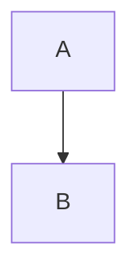

# Notion port design record

Status: proposed, stage 1 of the Notion port. Reference commit: `fae7be4`. Measured on 2026-11-24.

This record is the design for a port of `obsidian-mind` in which one Notion workspace is the only store of notes. Obsidian and local Markdown notes stop being a source of truth. Each reader, local or remote, reads through Notion MCP. Each write comes from a Claude Code session that loads the hooks of this repository.

A merge of this file to `main` is the approval for stage 2. Stage 2 follows part (e) and reports each deviation.

## How to read this record

- Part (a) gives the live measurements. Each number has its run count and its spread.
- Part (b) gives one verdict for each capability at `fae7be4`.
- Part (c) gives the content model.
- Part (d) gives the equivalence table that the parity test uses.
- Part (e) gives the ordered pull requests for stage 2.
- Part (f) gives the choices that belong to the operator.

Each claim has one of three labels. "Measured" means a live run in the workspace or a local run on `fae7be4`. "Documented" means a Notion or Claude Code document says it and no run confirmed it. "Inferred" means a conclusion from the other two.

The record holds no workspace ID, user ID, page ID, or local path, because `origin` is public. Placeholders such as `<page-id>` replace them.

## The operator decision that shapes the write path

During stage 1, the operator decided that Claude Code reaches Notion through `mcporter`, as OpenCode does. No native Notion server goes into `.mcp.json`. So a Notion write from Claude Code is a `Bash` tool call such as `mcporter call notion.notion-create-pages --args '<json>'`. The hooks match `Bash` and parse the command. The original `Write|Edit` matcher stays for the local files that remain, such as agent memory files.

## (a) Measurements

The scripts for these runs live in an uncommitted scratch worktree, because this pull request changes one file only. PR 3 in part (e) commits the parity harness that repeats them.

### a.1 Workspace and plan

- Measured. `notion-get-self` returns the workspace ID that the Goal names.
- Measured (`tool-access.json`). `notion-get-tool-access` reports 57 tools `available`, `notion-query-data-sources` as `available_with_limit`, and `notion-query-multiple-data-sources` as `full_version_required`.
- Measured. Nine tools report `plan_required`: `query_meeting_notes`, `connector_search`, `update_comment`, `delete_comment`, `set_discussion_resolved`, `set_comment_reaction`, `create_suggested_edit`, `get_suggested_edit`, and `resolve_suggested_edit`. The port needs none of them.
- Documented in the `notion-search` schema. It restricts six parameters to Business or Enterprise: editor filter, last-edited date range, more than one teamspace, title-only search, content status, and sort other than relevance.
- Inferred. The plan is neither Business nor Enterprise.
- Documented. SQL mode of `notion-query-data-sources` has a shared workspace limit on this plan. View mode has no tool-specific quota. The quota of rows mode is not documented.

### a.2 Hook input for a Notion write

A headless Claude Code 2.1.329 session in the scratch worktree ran one `mcporter call notion.notion-create-pages` command through `Bash`. Capture hooks on `PreToolUse` and `PostToolUse` with matcher `Bash` wrote their stdin to files. The payloads follow, verbatim except for the placeholders.

`PreToolUse`:

```json
{
 "session_id": "<session-id>",
 "transcript_path": "<transcript-path>",
 "cwd": "<scratch-worktree>",
 "prompt_id": "<prompt-id>",
 "permission_mode": "auto",
 "effort": {
  "level": "high"
 },
 "hook_event_name": "PreToolUse",
 "tool_name": "Bash",
 "tool_input": {
  "command": "mcporter call notion.notion-create-pages --args '{\"parent\":{\"page_id\":\"<page-id>\"},\"allow_async\":false,\"pages\":[{\"properties\":{\"title\":\"hook capture page\"},\"content\":\"Line one of the body.\\\\n\\\\n[[North Star]]\"}]}'",
  "description": "Create a Notion page through mcporter"
 },
 "tool_use_id": "<tool-use-id>"
}
```

`PostToolUse`:

```json
{
 "session_id": "<session-id>",
 "transcript_path": "<transcript-path>",
 "cwd": "<scratch-worktree>",
 "prompt_id": "<prompt-id>",
 "permission_mode": "auto",
 "effort": {
  "level": "high"
 },
 "hook_event_name": "PostToolUse",
 "tool_name": "Bash",
 "tool_input": {
  "command": "mcporter call notion.notion-create-pages --args '{\"parent\":{\"page_id\":\"<page-id>\"},\"allow_async\":false,\"pages\":[{\"properties\":{\"title\":\"hook capture page\"},\"content\":\"Line one of the body.\\\\n\\\\n[[North Star]]\"}]}'",
  "description": "Create a Notion page through mcporter"
 },
 "tool_response": {
  "stdout": "{\n  \"pages\": [\n    {\n      \"id\": \"<page-id>\",\n      \"url\": \"https://app.notion.com/p/<page-id>?pvs=204\",\n      \"properties\": {\n        \"title\": \"hook capture page\"\n      }\n    }\n  ]\n}",
  "stderr": "",
  "interrupted": false,
  "isImage": false,
  "noOutputExpected": false
 },
 "tool_use_id": "<tool-use-id>",
 "duration_ms": 2074
}
```

What the payloads show:

- Measured. `PreToolUse` carries the full write arguments before the write. A hook can check the content and deny the call, with no Notion call.
- Measured. `PostToolUse` adds `tool_response.stdout`, which holds the ID and the URL of each new page.
- Measured. The agent escaped the backslash twice inside single quotes, so the page body stores a literal `\n` instead of a line break. `notion-get-version-changes` shows the stored text. A model that writes inline JSON in a shell argument makes this kind of escape error, and choice 7 in part (f) addresses it.
- Measured (`native-mcp-auth.txt`). Without a Notion login inside Claude Code, a native `.mcp.json` server gives no tools in a headless session. Claude Code reports "require authentication", and a headless session cannot run OAuth. The `mcporter` path needs no second login.
- Documented. `notion-create-pages` defaults `allow_async` to true. An async result returns a task, not page IDs. The write hook needs page IDs, so the write form must set `allow_async: false`.

### a.3 Wall time of each Notion call

In-process calls through the `mcporter` runtime, one warm connection, 10 runs each, 0 errors (measured):

| Call | Runs | Min ms | p50 ms (6th of 10 sorted) | Max ms |
|---|---|---|---|---|
| `notion-get-self` | 10 | 325 | 364 | 1009 |
| `notion-fetch` | 10 | 352 | 371 | 410 |
| `notion-search` | 10 | 367 | 435 | 488 |
| `notion-list-page-backlinks` | 10 | 342 | 370 | 408 |
| `notion-update-page`, `update_properties` | 10 | 359 | 397 | 432 |
| `notion-create-pages`, synchronous | 10 | 402 | 470 | 600 |

A hook is a new process for each event, so the cold cost matters more (measured):

| Form | Runs | Min | Median | Max |
|---|---|---|---|---|
| `mcporter call notion.notion-fetch` CLI, new process | 10 | 802 ms | 961 ms | 1310 ms |
| New Node process: import the `mcporter` runtime, connect, one `notion-fetch` | 10 | 0.70 s | 0.80 s | 0.86 s |
| `mcporter` write from Claude Code `Bash`, `duration_ms` in the payload | 1 | 2074 ms | 2074 ms | 2074 ms |

Database and view calls, one run each (measured):

| Call | ms |
|---|---|
| `notion-create-database` | 866, 1041 |
| `notion-update-data-source`, three columns added | 466 |
| `notion-create-view` | 401 to 2373, 9 views |
| `notion-query-data-sources`, view mode | 419 to 470, 9 views |
| `notion-query-data-sources`, rows mode | 464, 1426 |
| `notion-query-data-sources`, SQL mode | 484 |

A stand-in for the Stop hook ran in a new Node process. It imported the runtime and ran 8 view queries, 10 runs for each concurrency (measured):

| Concurrency | Runs | Min | Median | Max | Errors |
|---|---|---|---|---|---|
| 1 | 10 | 3.67 s | 4.10 s | 6.00 s | 0 |
| 4 | 10 | 1.25 s | 1.59 s | 2.68 s | 0 |

The original hooks at `fae7be4` ran on the template scaffold, with `qmd` kept off `PATH`, 10 runs each (measured). The run left `git status` clean.

| Hook | Timeout | Min | Median | Max | Distinct outputs |
|---|---|---|---|---|---|
| `session-start.ts` | 30 s | 142 ms | 151 ms | 165 ms | 1 |
| `classify-message.ts` | 15 s | 89 ms | 91 ms | 98 ms | 2 |
| `validate-write.ts` | 15 s | 113 ms | 119 ms | 128 ms | 1 |
| `pre-compact.ts` | 30 s | 104 ms | 110 ms | 130 ms | 1 |
| `stop-checklist.ts` | 5 s | 113 ms | 123 ms | 137 ms | 2 |

The two hooks with two outputs keep per-session state. The first run emits the hints or the report, and later runs with the same `session_id` emit nothing (`classify-message.ts:51-56`, `stop-checklist.ts:176`). The parity harness must reset the hook state before each run. Otherwise the second run looks like a regression.

What limits the numbers (inferred): one network round trip to the hosted server, about 350 ms, sets the floor of each call. The cold forms add process start and connection setup. Parallel queries cut the Stop stand-in by about 2.6 times at concurrency 4. A run that only the round trip limits would be about 4 times faster, so a second limit is present. No profile names it.

### a.4 Request budget and calls for each hook

- Measured. A burst of `notion-get-self` calls at concurrency 8 sent 182 calls, and 174 passed. The first `rate_limited` reply came at call 173, at 7.6 s, with "Wait at least 9 seconds before retrying this tool call." Two calls in flight passed after it.
- Documented on the Notion request-limits page (`developers.notion.com/reference/request-limits`). The limit is 180 requests in each 60 s window on plans other than Business and Enterprise. The burst agrees with it.
- Inferred. A rate-limit retry costs at least 9 s. A hook with a 5 s timeout cannot absorb one retry.

Calls for each hook run under the design in part (c). These counts are estimates (inferred). PR 6 to PR 8 measure them.

| Hook | Notion calls for each run | Estimated wall time | Timeout |
|---|---|---|---|
| SessionStart | 1 fetch (North Star), 1 query (brain index), 7 queries (recent edits), 1 query and 1 to 3 fetches (open tasks), 1 query (active work), 7 or more queries (titles), about 10 queries (hygiene): about 30 to 35 | about 3 to 5 s at concurrency 4 | 30 s, kept |
| UserPromptSubmit | 0 | same as today | 15 s, kept |
| PostToolUse write check | 0 for a full write. 1 fetch for a partial update. 1 query (topic cluster). 1 update (derived properties). | about 1.2 to 2.0 s | 15 s, kept |
| PreCompact | 0 | same as today | 30 s, kept |
| Stop | about 10 view queries: "Hygiene: oversized" on each of 7 databases, plus 3 Work views | about 1.6 to 3.5 s at concurrency 4. The stand-in measured 8 queries. | 5 s to 15 s, proposed |

With these counts, one session start uses about one sixth of the 60 s budget. A busy minute with one start, five writes, and five Stop events stays near 80 calls (inferred).

### a.5 Markdown that `notion-fetch` returns for a fixture note

The fixture is a work note that holds each Obsidian construct the vault rules use. The import tool removes the frontmatter and writes it as properties, so the test sends only the body.

Source body:

````markdown
# Fixture Work Note

## Context

This note links to [[North Star]], to [[Key Decisions|the decision log]], and to [[Patterns#Error handling]].
It also links to a block with [[Gotchas#^hook-timeout]].

A paragraph line that the hygiene check calls hard-wrapped
continues on the next line
and on one more line.

> [!warning] Footgun
> A callout with **bold** and `code`.

## What

- [ ] An open task
- [x] A closed task
- A bullet with a tag #inline-tag
- A ==highlight== and a %%hidden comment%%

| Column A | Column B |
| --- | --- |
| one | two |

```ts
const x: number = 1;
```



A line with a block id. ^fixture-block

![[Patterns]]

## Related

- [[Index]]
- [[Platform]]
````

The `<content>` that `notion-fetch` returns for the raw body (measured):

````markdown
# Fixture Work Note

## Context

This note links to \[\[North Star\]\], to \[\[Key Decisions\|the decision log\]\], and to \[\[Patterns#Error handling\]\].<br />It also links to a block with \[\[Gotchas#\^hook-timeout\]\].

A paragraph line that the hygiene check calls hard-wrapped<br />continues on the next line<br />and on one more line.

> \[!warning\] Footgun<br />A callout with <b>bold</b> and <code>code</code>.

## What

- [ ] An open task
- [x] A closed task

- A bullet with a tag #inline-tag
- A ==highlight== and a %%hidden comment%%

| Column A | Column B |
| --- | --- |
| one | two |

```ts
const x: number = 1;
```


A line with a block id. \^fixture-block

!\[\[Patterns\]\]

## Related

- \[\[Index\]\]
- \[\[Platform\]\]
````

A second page used Notion-flavored Markdown for the same constructs: `<mention url="...">`, a trailing `\` hard break, `<callout>`, and `<span color="yellow_bg">`. Its fetch returned (measured, IDs replaced):

```markdown
## Context

This note links to <mention url="https://app.notion.com/p/<target-id>">timing target 1795492147644</mention>, and to <mention url="https://app.notion.com/p/<target-id>">timing target 1795492147644</mention>.

A paragraph line that the hygiene check calls hard-wrapped<br />continues on the next line.

<callout icon="⚠️" color="yellow_bg">
Footgun. A callout with <b>bold</b> and <code>code</code>.
</callout>

A <span color="yellow_bg">highlight</span>.

## Related

- <mention url="https://app.notion.com/p/<target-id>">timing target 1795492147644</mention>
```

`notion-list-page-backlinks` on the target then returned one `page_mention` from the converted page (measured).

Constructs and what Notion keeps (measured unless marked):

| Construct | Raw body result | Import tool action |
|---|---|---|
| Headings, task lists, pipe tables, fenced code, Mermaid fence | Kept | Copy |
| `[[Note]]`, `[[Note\|alias]]` | Escaped literal text, no link | Convert to `<mention url>`. The alias is lost, because the mention shows the current title of the target. |
| `[[Note#Heading]]` | Escaped literal text | Mention of the page. The heading anchor is lost. |
| `[[Note#^block]]`, `^block-id` | Escaped literal text | Mention of the page. Notion has no named block anchor (inferred from the Markdown spec). |
| `![[Note]]` embed | Escaped literal text | Mention, or a `<synced-block>` only for a block that the tool creates (inferred) |
| `> [!type] Title` callout | Quote with literal `[!type]` | Convert to `<callout>` |
| `==highlight==` | Literal text | Convert to `<span color="yellow_bg">` |
| `%%comment%%` | Literal text | Remove, and list the removal in the import report |
| Inline `#tag` | Literal text | Keep as text. Frontmatter tags go to the `Tags` property. |
| Hard-wrapped paragraph lines | One paragraph with `<br />` | Join the lines. The hard-wrap check flags the defect in Notion too. |
| Frontmatter | Not sent. Outside a database, only `title` is allowed (documented). | Write as database properties |
| A leading `# Title` heading | Kept as a heading. Duplicates the page title. | Remove when it equals the title |
| Blank line between task items and plain items | Notion splits the list in two | Accept |

### a.6 Database and view behavior

A test database under the scratch root had `Type`, `Status`, `Date`, `Quarter`, `Tags`, `Description`, a `last_edited_time` named `Edited`, and a formula `Stale` = `dateBetween(now(), prop("Edited"), "days") > 14`. A second database came later, with one relation to it and one two-way self-relation. Each view was read back after creation (measured):

| View directive | Saved | Query result |
|---|---|---|
| `FILTER "Status" = "active"; SORT BY "Date" DESC; SHOW ...` | Yes | The 2 active rows, in date order |
| `FILTER "Stale" = TRUE` on a formula | Yes | 0 rows, correct for new rows |
| `GROUP BY "Type"` on a select | Yes | 3 rows |
| `FILTER "Edited" >= "one_week_ago"` on `last_edited_time` | Yes | 3 rows |
| `FILTER "Tags" CONTAINS "work-note"; SORT BY "Tags" ASC` on a multi-select | Yes | 3 rows |
| `GROUP BY "Team"` on a relation | Yes, `propertyType: "relation"` | 3 rows |
| `FILTER "Related" IS EMPTY` on a relation | Yes | 3 rows |
| Linked view on a plain page, `parent_page_id` | Yes | The 2 active rows |
| `GROUP BY "QuarterF"` on a formula | Not shown. The call reported success, and the read-back has no `groupBy`. | Rows. A query result cannot show groups. |

Limits of this test (measured):

- The "Stale formula" view reads back with `"filters": []`, but its query returns 0 of 3 rows. So a formula filter works, and the read-back does not show it.
- The same blind read-back is the only evidence on `GROUP BY` of a formula. So "a view cannot group on a formula" is inferred, not measured.
- Five views returned all 3 rows. A server that dropped those directives would give the same result. A query result also cannot show groups.

Two rules follow for the setup in PR 4:

- The setup reads back each saved view and compares it with the request. A success reply from `notion-create-view` is not proof. For a directive on a formula, the setup checks the query result instead. Each test view gets one row that it must return and one row that it must exclude.
- `Quarter` is a select that the write hook and the import tool set, not a formula. Grouping on a formula is not proven, and a select is safe.

Other measured facts:

- Rows mode returns formula values as `formulaResult://` references, not as values. SQL mode lists the formula in `notAvailableInQuerySql`. A hook that needs a formula value must use a view filter.
- `notion-get-version-changes` reports `"source": "mcp"` and the same user for a write from Claude Code `Bash` and for a write from a local runtime script. It does not name the client.

### a.7 Throwaway pages

The run created one private root page, 18 child pages and database rows, and 2 databases with 9 saved views. Before this pull request opened, the run moved all 21 objects to Trash with `notion-delete-pages` and `notion-delete-databases`. A fetch of the root then showed it as deleted, and four `notion-search` queries for the test titles returned no results (measured, `search-after-trash.txt`).

## (b) Capability ledger

Each row has one verdict:

- `ported` means the capability stays, with the edit that the reason names.
- `replaced` means a named Notion feature does the job.
- `on-demand` means a command that the operator runs does the job. A hook does not.
- `removed` means the capability goes, with the reason.

Each table ends with its totals. The hook rows and the rules rows come from a script over the four stage 1 inventories. The view, command, and subagent rows are written by hand.

### Ledger rows for the views in `bases/`

| Base file | View | Verdict | Notion replacement |
|---|---|---|---|
| `1-1 History.base` | (one view) | replaced | Work view "1:1 History", `FILTER "Type" = "1:1"; SORT BY "Date" DESC` |
| `Competency Map.base` | (one view) | replaced | Competencies view, `Evidence count` rollup over the `Evidence` relation, `SORT BY "Evidence count" DESC` |
| `Incidents.base` | (one view) | replaced | Work view "Incidents", `FILTER "Type" = "Incident"; SORT BY "Date" DESC` |
| `Memories.base` | Recent | removed | Cross-repository memory is out of scope |
| `Memories.base` | By project | removed | Cross-repository memory is out of scope |
| `Memories.base` | Needs review | removed | Cross-repository memory is out of scope |
| `Memories.base` | Superseded | removed | Cross-repository memory is out of scope |
| `Memories.base` | General reach | removed | Cross-repository memory is out of scope |
| `People Directory.base` | By Team | replaced | People view, `GROUP BY "Team"` on the relation (measured to save) |
| `People Directory.base` | All People | replaced | People view, `SORT BY "Name" ASC` |
| `Recently Touched.base` | Last 7 Days | replaced | One linked view per database on the "Recently Touched" page, `FILTER "Changed" >= "one_week_ago"` (choice 6) |
| `Recently Touched.base` | Recent 30 | replaced | Same page, `SORT BY "Changed" DESC`. The reader sets `page_size` 30. |
| `Recently Touched.base` | Work Only | replaced | Work view, `SORT BY "Changed" DESC` |
| `Review Evidence.base` | By Cycle | replaced | Perf docs view, `FILTER "Type" = "PR evidence"; GROUP BY "Cycle"` |
| `Review Evidence.base` | By Person | replaced | Perf docs view, `GROUP BY "Person"` on the relation |
| `Templates.base` | (one view) | replaced | Templates database, default view |
| `Work Dashboard.base` | Active Work | replaced | Work view, `FILTER "Status" = "active"; GROUP BY "Project"` |
| `Work Dashboard.base` | All by Quarter | replaced | Work view, `GROUP BY "Quarter"` on the select |
| `Work Dashboard.base` | Stale Actives | replaced | Work view, `FILTER "Status" = "active"; FILTER "Stale" = TRUE` with the 14-day formula |
| `Work Dashboard.base` | Completed | replaced | Work view, `FILTER "Status" = "completed"; GROUP BY "Quarter"` |

Totals: 20 views, replaced 15, removed 5.

Known losses (measured or documented):

- The view DSL has no `LIMIT`. A reader sets `page_size` instead.
- `GROUP BY` has no direction, so the "DESC" group order of two views is lost.
- "Recently Touched" cannot be one list across databases on this plan. Option B in choice 6 is the only layout that keeps one list.
- The competency `Evidence count` counts relation links only. Obsidian counted each body wikilink.

### Ledger rows for the commands and subagents

The proposed verdicts come from the command inventory. Two merges stay out of this port (choice 11).

| File | Verdict | Main Notion tools | Edit |
|---|---|---|---|
| `om-capture-1on1` | ported | `notion-create-pages`, `notion-search`, `notion-update-page` | Use the Work database with `Type = 1:1` |
| `om-correct` | ported | `notion-search`, `notion-fetch`, `notion-update-page` | Report a page URL and a quote, not `path:line` |
| `om-dump` | ported | `notion-search`, `notion-create-pages`, `notion-update-page` | Route by database and `Type` |
| `om-humanize` | ported | `notion-fetch`, `notion-update-page` | None beyond the tools |
| `om-incident-capture` | ported | `notion-create-pages`, `notion-search`, `notion-update-page` | Incident properties on Work |
| `om-intake` | ported | `notion-query-data-sources`, `notion-fetch`, `notion-create-pages`, `notion-delete-pages` | The inbox is `Type = Inbox item` |
| `om-meeting` | ported | `notion-search`, `notion-fetch` | None beyond the tools |
| `om-peer-scan` | ported | `notion-create-pages`, `notion-search` | Perf docs database |
| `om-prep-1on1` | ported | `notion-query-data-sources`, `notion-fetch` | Query by the `Person` relation |
| `om-project-archive` | ported | `notion-update-page` | Archive is a `Status` change. No `git mv`. |
| `om-review-brief` | ported | `notion-query-data-sources`, `notion-fetch`, `notion-create-pages` | Local HTML and PDF output stays local |
| `om-review-peer` | ported | `notion-fetch`, `notion-search`, `notion-create-pages` | None beyond the tools |
| `om-self-review` | ported | `notion-fetch`, `notion-query-data-sources`, `notion-create-pages` | None beyond the tools |
| `om-slack-scan` | ported | `notion-search`, `notion-update-page` | None beyond the tools |
| `om-standup` | ported | `notion-fetch`, `notion-query-data-sources` | Reads the SessionStart context |
| `om-tidy` | ported | `notion-query-data-sources`, `notion-list-page-backlinks`, `notion-create-pages` | The memory-inbox part and `tidy-fix.ts` go |
| `om-vault-audit` | ported | `notion-query-data-sources`, `notion-list-page-backlinks`, `notion-fetch` | Also refreshes derived properties and finds edits outside the hooks (choices 5 and 8) |
| `om-vault-upgrade` | removed (choice 3) | none | ShardMind upgrade has no Notion form. Its import mode moves to the import tool. |
| `om-weekly` | ported | `notion-query-data-sources`, `notion-fetch`, `notion-get-version-changes` | `git log` becomes a `last_edited_time` query |
| `om-wrap-up` | ported | `notion-fetch`, `notion-list-page-backlinks`, `notion-update-page` | The memory index step goes |
| `brag-spotter` | ported | `notion-query-data-sources`, `notion-fetch` | `git log` becomes a `last_edited_time` query |
| `context-loader` | ported | `notion-search`, `notion-fetch`, `notion-list-page-backlinks` | None beyond the tools |
| `correction-sweep` | ported | `notion-search`, `notion-fetch` | Report a page URL and a quote |
| `cross-linker` | ported | `notion-fetch`, `notion-list-page-backlinks`, `notion-update-page` | Writes the relation property as well as the mention |
| `people-profiler` | ported | `notion-search`, `notion-create-pages`, `notion-update-page` | People database |
| `review-fact-checker` | ported | `notion-fetch`, `notion-search` | None beyond the tools |
| `review-prep` | ported | `notion-query-data-sources`, `notion-fetch`, `notion-create-pages` | None beyond the tools |
| `slack-archaeologist` | ported | `notion-create-pages`, `notion-search` | None beyond the tools |
| `vault-librarian` | ported | `notion-list-page-backlinks`, `notion-query-data-sources`, `notion-fetch` | Orphan checks become relation-empty view filters |
| `vault-migrator` | on-demand (choice 3) | none | Its heuristics feed the import tool in PR 11 |

Totals: 30 files, ported 28, on-demand 1, removed 1.

Each subagent already has `Bash` on its `tools:` line, so it can call Notion through `mcporter`. Each one loses the `qmd` skill and the Obsidian skills (`.claude/agents/*.md:4-10`).

A full link-graph scan in `om-vault-audit`, `vault-librarian`, and `cross-linker` costs about one call for each page and kind of link. For 500 notes that is 1,000 to 1,500 calls, so 6 to 9 minutes at 180 calls each minute (inferred). These steps stay on-demand and need a pacer that waits on `rate_limited`.

### Ledger rows for the hooks

Source: `hooks.md` inventory of `fae7be4`. One row for each check or behavior.

| ID | Capability | Source | Verdict | Reason |
|---|---|---|---|---|
| SS-01 | Read the SessionStart payload (source, session_id, om_reinject) with a 2 s deadline. Fail open to full mode. | session-start.ts:98-122 | ported | Same payload read. |
| SS-02 | Append the VAULT_PATH export line to CLAUDE_ENV_FILE. Runs even under standdown. | session-start.ts:134-146, lib/session-start.ts:393-402 | ported | The repository root stays the `VAULT_PATH`. |
| SS-03 | Stand down when om_mod is "standdown": exit 0 with no output. | session-start.ts:156-157, lib/om-mod.ts:36-40 | ported | Kept while the mod stays (choice 3). |
| SS-04 | Gemini re-injection: if a stored context exists for the session id, take it and force full mode. | session-start.ts:163-165, lib/reinject.ts:66-69 | removed | Gemini is out of scope. |
| SS-05 | Choose injection mode. resume and compact give pointer mode. startup, clear and unknown give full mode. | session-start.ts:165,635-641, lib/session-start.ts:916-918 | ported | Same mode rule. |
| SS-06 | Read vault-manifest.json once. It feeds qmd_index, qmd_min_version, infrastructure, budgets, listing_collapse_threshold, open_loop_dirs, open_loop_sections, memory_root. | session-start.ts:124-130,173-174, lib/session-start.ts:250-340,735-788 | ported | Reads `vault-manifest.json` and `notion-map.json`. |
| SS-07 | QMD ABI self-heal. Run `qmd --index <i> status` (5 s). If stderr shows an ABI mismatch, run `npm rebuild better-sqlite3` (20 s) and add a note. | session-start.ts:207-236, lib/session-start.ts:704-733 | removed | QMD is out of scope. |
| SS-08 | QMD minimum version warning from the manifest qmd_min_version. Run `qmd --version` (5 s). | session-start.ts:242-255, lib/qmd.ts:372-380 | removed | QMD is out of scope. |
| SS-09 | QMD store check. If the sqlite store is missing or smaller than 500,000 bytes, spawn the detached bootstrap. Else spawn a detached `qmd update`. Skipped when VAULT_QMD_REFRESH=off. | session-start.ts:257-298, lib/session-start.ts:899-907 | removed | QMD is out of scope. |
| SS-10 | Emit the Date section. | session-start.ts:601-605, lib/session-start.ts:347-353 | ported | No Notion data. |
| SS-11 | North Star section. Read brain/North Star.md. Keep from "## Current Focus". Drop the Shifts Log and finished items. Degrade by level: full, focus, headlines, top-N, pointer. | session-start.ts:326-354, lib/session-start.ts:925-1069 | ported | One `notion-fetch` of the North Star page. |
| SS-12 | Brain Topics index. One line per brain/*.md except North Star and Memories: "`- [[Name]] — description`", plus " (empty)" when no bullet exists. | session-start.ts:437-462, lib/session-start.ts:498-545,869-884 | ported | One view query on Knowledge, `Type = Brain topic`, with `Description`. |
| SS-13 | Recent Changes. `git log --oneline --since="48 hours ago" --no-merges`, first 15 lines. | session-start.ts:369-382, lib/session-start.ts:420-426 | replaced | Replaced by a `last_edited_time` query per database for the last 48 hours. |
| SS-14 | Open Tasks. Scan work/active/*.md (top level) then root *.md, skipping infrastructure files. Collect `- [ ]` lines. Limit 10. Group by source path. | session-start.ts:414-435, lib/session-start.ts:837-859 | ported | Query on the derived `Open tasks` property, then one fetch per hit. |
| SS-15 | Active Work. List file names in work/active (top level), strip .md, first 10. | session-start.ts:464-474, lib/session-start.ts:404-413 | ported | One view query on Work, `Status = active`. |
| SS-16 | Vault File Listing. Walk all .md files. Skip machinery dirs and thinking/. Always collapse work/archive. Collapse flat dirs with more than 12 notes (manifest listing_collapse_threshold). | session-start.ts:477-579, lib/session-start.ts:230-248,433-472 | ported | One view query per database for titles. |
| SS-17 | Hygiene section. Run scanActiveHygiene and print the lines when drift exists. Never degrades under the budget. | session-start.ts:658-675 | ported | Runs the HY rows. |
| SS-18 | Budget ladder. Degrade sections by priority (file listing first, then brain index, North Star, recent changes). Hold the total under the budget. Hook path: 9,500 JSON chars. Deliver path: 20,000 bytes default. | session-start.ts:585-599,677-715, lib/session-start.ts:156-210,270-335 | ported | Same budget ladder. |
| SS-19 | Emit one JSON envelope (hookSpecificOutput.additionalContext, event SessionStart). Under the mod "deliver" mode, emit plain text. | session-start.ts:696-717, lib/hook-io.ts:61-80,137-243 | ported | Same envelope. |
| UP-01 | Read the prompt payload. Exit 0 silently on empty or bad JSON. | classify-message.ts:33-37 | ported | Pure text match on the prompt. No Notion data. |
| UP-02 | Hand over the Stop report. Claim the session file by rename, read it, delete it. Add it to the output. | classify-message.ts:39-43,71, lib/stop-handoff.ts:72-96 | ported | No Notion data. Local state only. |
| UP-03 | Signal DECISION (patterns: decided, decision, we chose, agreed to, and 3 CJK sets). | lib/signals.ts:36-75, lib/matcher.ts:13-55 | ported | Pure text match on the prompt. No Notion data. |
| UP-04 | Sub-hint DECISION reversal (reversed, superseded, changed our mind, rolled back the decision, overturned, un-decided). Fires only when DECISION matches. | lib/signals.ts:39-50, lib/matcher.ts:50-52 | ported | Pure text match on the prompt. No Notion data. |
| UP-05 | Signal INCIDENT (incident, outage, pagerduty, severity, p0 p1 p2, sev1, sev2, postmortem, rca, CJK). | lib/signals.ts:77-104 | ported | Pure text match on the prompt. No Notion data. |
| UP-06 | Signal 1:1 CONTENT (1:1, 1-1, 1-on-1, one on one, 1on1, catch up with, sync with, CJK). | lib/signals.ts:105-126 | ported | Pure text match on the prompt. No Notion data. |
| UP-07 | Signal WIN (shipped, launched, completed, released, deployed, achieved, won, promoted, kudos, CJK and more). | lib/signals.ts:127-176 | ported | Pure text match on the prompt. No Notion data. |
| UP-08 | Signal ARCHITECTURE (architecture, system design, rfc, tech spec, trade-off, design doc, adr, CJK). | lib/signals.ts:177-201 | ported | Pure text match on the prompt. No Notion data. |
| UP-09 | Signal PERSON CONTEXT (told me, said that, feedback from, met with, talked to, spoke with, mentioned that/the/a, CJK). | lib/signals.ts:202-232 | ported | Pure text match on the prompt. No Notion data. |
| UP-10 | Signal PROJECT UPDATE (project update, sprint, milestone, delivery verbs, went live, rolled out, merged, cut the release, CJK). | lib/signals.ts:233-286 | ported | Pure text match on the prompt. No Notion data. |
| UP-11 | Once-per-session dedupe. Each hint fires once per session id. State is pruned after 7 days or 200 sessions. Fails open without a session id. | classify-message.ts:51-60, lib/hint-state.ts:39-40,147-159 | ported | No Notion data. Local state only. |
| UP-12 | Wrap the hints in one block. | classify-message.ts:62-70 | ported | No Notion data. Local state only. |
| UP-13 | Gemini re-injection hand-over. Take the stored session context once and append it last. | classify-message.ts:72-76, lib/reinject.ts:66-69 | removed | Gemini is out of scope. |
| UP-14 | Emit one JSON envelope (hookSpecificOutput.additionalContext) only when parts exist. Cap 9,500 JSON chars. | classify-message.ts:78-87, lib/hook-io.ts:61-80 | ported | No Notion data. Local state only. |
| VW-01 | Find the written file path from tool_input.file_path (Claude Code). Codex apply_patch headers are also parsed. | validate-write.ts:60-68, lib/write-targets.ts:62-97 | replaced | Replaced by a parser for `Bash` commands of the form `mcporter call notion.<write tool>`. |
| VW-02 | Debounced QMD refresh for any in-vault .md write. Spawn a detached worker. Debounce 30 s with sentinel and trailing flush. Runs before the skip ladder. | validate-write.ts:70-87, lib/qmd-refresh.ts:68-85,338-401 | removed | QMD is out of scope. |
| VW-03 | Memory location guard. A file under ~/.claude/**/memory/ other than MEMORY.md is a violation. Checks the lexical and the realpath form. | validate-write.ts:111-154, lib/frontmatter.ts:46-55 | ported | Stays on the `Write\|Edit` matcher. It guards local agent memory files. |
| VW-04 | Skip a file outside the vault root. | validate-write.ts:156-162, lib/project-dir.ts:58-66 | ported | A target that `notion-map.json` does not name is skipped. |
| VW-05 | Skip ladder. Skip non-.md, ROOT_FILES (README, CHANGELOG, CONTRIBUTING, ARCHITECTURE, CLAUDE, AGENTS, GEMINI), README.*.md, and paths with .claude/ .codex/ .gemini/ .github/ .obsidian/ templates/ thinking/. | validate-write.ts:164-167, lib/frontmatter.ts:10-28,61-76 | ported | The skip ladder maps to targets outside the note databases. |
| VW-06 | Read the file once after the write. All checks use this one snapshot. | validate-write.ts:169-177 | ported | Content comes from `tool_input`. One fetch only for a partial update. |
| VW-07 | Missing YAML frontmatter (content does not start with "---"). | lib/frontmatter.ts:200-201 | ported | Runs on the write content in `tool_input` (equivalence in part d). |
| VW-08 | Missing global frontmatter fields: date, description, tags (or the manifest global set). A key counts if its line exists, even if empty. | lib/frontmatter.ts:81-186,194-219 | ported | Runs on the write content in `tool_input` (equivalence in part d). |
| VW-09 | Missing typed fields by folder. work/incidents (incident tag only), work/1-1, work/active and work/archive, org/people, org/teams. | lib/frontmatter.ts:91-106,159-180,211-217 | ported | Runs on the write content in `tool_input` (equivalence in part d). |
| VW-10 | No wikilinks. The text is longer than 300 chars and has no "[[". | lib/frontmatter.ts:221-225 | ported | Runs on the write content in `tool_input` (equivalence in part d). |
| VW-11 | Hard-wrapped paragraph lines. A prose line that continues a paragraph. Structure (code, tables, lists, headings, callouts, comments, math) is never counted. verbatim: true opts out. | lib/frontmatter.ts:227-233, lib/prose-width.ts:26-146 | ported | Runs on the write content in `tool_input` (equivalence in part d). |
| VW-12 | Ticket-ID wikilinks such as `[[PROJ-123]]`. Also emits policy result phantom-edge. | lib/frontmatter.ts:235-254, validate-write.ts:192-201 | ported | Runs on the write content in `tool_input` (equivalence in part d). |
| VW-13 | Warning envelope for one file: header, one bullet per warning, closing line. | validate-write.ts:186-191 | ported | Same envelope. |
| VW-14 | Oversized note. File size is 25,000 bytes or more and the name has no "Archive". Emits policy result organization-threshold. | validate-write.ts:209-225, lib/active-hygiene.ts:329-334,671-673 | ported | Byte size of the page Markdown. Also writes the derived `Bytes` property. |
| VW-15 | Topic cluster. The written note sits loose in work/active root and shares a distinctive title token with another root note. Needs 4 or more root notes. Token in 2 or more files and at most half of them. Emits policy result topic-cluster. | validate-write.ts:226-240, lib/active-hygiene.ts:75-94,377-423,648-669 | ported | One view query on Work titles. |
| VW-16 | Merge the findings of all targets into one envelope. Remove duplicate blocks. A throwing file costs only itself. | validate-write.ts:245-265 | ported | Same merge. |
| VW-17 | Emit one JSON envelope (hookSpecificOutput.additionalContext plus policyResults). Policy results are dropped when they do not fit under 9,500 JSON chars. | validate-write.ts:257-265, lib/hook-io.ts:53-80 | ported | Same envelope. |
| PC-01 | Read the payload. Exit 0 on empty or bad JSON. | pre-compact.ts:69-71 | ported | No Notion data. |
| PC-02 | Debounced QMD refresh before the backup. Same sentinel as VW-02 and ST-12. | pre-compact.ts:73-86, lib/qmd-refresh.ts:338-401 | removed | QMD is out of scope. |
| PC-03 | Back up the transcript. Copy transcript_path to thinking/session-logs/session_<trigger>_<YYYYMMDD_HHMMSS>.jsonl. | pre-compact.ts:111-146, lib/project-dir.ts:68-71 | ported | Copy moves to `.claude/state/session-logs/`, outside the note store (choice 12). |
| PC-04 | Keep the 30 newest backups. Delete older session_*.jsonl. | pre-compact.ts:36,46-67,148 | ported | Same retention of 30 backups. |
| PC-05 | Gemini only. On PreCompress, run session-start in a child process (20 s) and store the context for the next prompt. Prune old handoffs. | pre-compact.ts:97-107, lib/reinject.ts:37-57, lib/session-start-run.ts:26-58 | removed | Gemini is out of scope. |
| ST-01 | Stand down when om_mod is "standdown": write "{}" and exit. | stop-checklist.ts:98-105, lib/hook-io.ts:293-299 | ported | No Notion data. |
| ST-02 | Re-entry guard. If stop_hook_active or stopHookActive is true (and om_mod is not "report"), write "{}" and exit. | stop-checklist.ts:106-117 | ported | No Notion data. |
| ST-03 | Wrap-up checklist text (5 items). | stop-checklist.ts:119-128 | ported | No Notion data. |
| ST-04 | Run the hygiene scan and append "Vault Hygiene (drift detected):" with the lines. | stop-checklist.ts:130-157 | ported | Runs the HY rows as view queries. |
| ST-05 | Read vault-manifest.json (open_loop_*, infrastructure, memory_root). | stop-checklist.ts:133-148 | ported | Reads the renamed manifest fields. |
| ST-06 | Report identity key. SHA-256 prefix (16 hex) of the canonical report. Volatile fields sizeKb, ageDays, oldestDays are dropped and arrays are sorted. | stop-checklist.ts:164-168, lib/report-key.ts:24-49, lib/active-hygiene.ts:103 | ported | No Notion data. |
| ST-07 | Stop dedupe. Show the report once per session. Show it again only when the key changes. Fails open without a session id. | stop-checklist.ts:176, lib/hint-state.ts:168-185 | ported | No Notion data. |
| ST-08 | Report as data for the mod (om_mod "report"). Print JSON {report:{key,claims,agentText}}. No state, no handoff. | stop-checklist.ts:170-175, lib/hook-io.ts:312-324, lib/stop-report.ts:21-26 | ported | No Notion data. |
| ST-09 | Hand-over. Prune old handoffs. Write the full report to the session handoff file. Emit a systemMessage summary to the user. UP-02 gives the report to the agent on the next prompt. | stop-checklist.ts:177-182, lib/stop-handoff.ts:61-114, lib/stop-report.ts:12-49 | ported | No Notion data. |
| ST-10 | Fallback. If the handoff write throws, emit Stop feedback: a systemMessage summary and hookSpecificOutput.additionalContext with the full report. | stop-checklist.ts:183-185, lib/hook-io.ts:264-272, lib/stop-report.ts:36-37 | ported | No Notion data. |
| ST-11 | Non-Stop event, or no session id: emit the full message as systemMessage. | stop-checklist.ts:159-163,187, lib/hook-io.ts:126-129 | ported | No Notion data. |
| ST-12 | Debounced QMD refresh. Runs after the report. | stop-checklist.ts:189-194, lib/qmd-refresh.ts:338-401 | removed | QMD is out of scope. |
| MOD-01 | SessionStart: run session-start.ts with om_mod "deliver" (30 s). Save the output as session context. Write it to .claude/session-context.md without waiting. Pass the event down with om_mod "standdown". If the run fails, rethrow so the settings hook runs. | .claude/skills/obsidian-mind/hooks/register.ts:104-138,89-102 | ported | Kept with the mod (choice 3). The mod runs the ported scripts. |
| MOD-02 | On a SessionStart that is not "compact": clear queued report, urgent flag, in-flight record, session context. Bump generation. | hooks/register.ts:106-125 | ported | Kept with the mod (choice 3). The mod runs the ported scripts. |
| MOD-03 | Add the session context as a project instruction file (or a block). Replace an earlier copy. | hooks/register.ts:140-145, hooks/context.ts:18-25 | ported | Kept with the mod (choice 3). The mod runs the ported scripts. |
| MOD-04 | Stop: skip on stop_hook_active. Else run stop-checklist.ts with om_mod "report" (5 s) and parse the report. | hooks/register.ts:147-159, hooks/stop.ts:23-36 | ported | Kept with the mod (choice 3). The mod runs the ported scripts. |
| MOD-05 | Per-session dedupe in the engine store "shown" (20 sessions kept). Same key and already delivered or queued: do nothing. | hooks/register.ts:65-82,160-176 | ported | Kept with the mod (choice 3). The mod runs the ported scripts. |
| MOD-06 | Queue the report with a summary line and an optional urgent text. | hooks/register.ts:170-177, hooks/stop.ts:46-52 | ported | Kept with the mod (choice 3). The mod runs the ported scripts. |
| MOD-07 | turn.complete: draw the line once under the next completed main-loop answer. Send one urgent turn per person prompt. The template report has no urgent class. | hooks/register.ts:180-207, hooks/stop.ts:59-61,15-19 | ported | Kept with the mod (choice 3). The mod runs the ported scripts. |
| MOD-08 | prompt.submit: add the queued report to the context of the person's next prompt. Put it back if the prompt is dropped. | hooks/register.ts:209-257, hooks/stop.ts:78-85 | ported | Kept with the mod (choice 3). The mod runs the ported scripts. |
| MOD-09 | turn.start: mark the report delivered when the prompt ran. Else requeue it. | hooks/register.ts:259-282, hooks/stop.ts:74-76 | ported | Kept with the mod (choice 3). The mod runs the ported scripts. |
| HY-01 | Completed notes still in active/. Frontmatter status is completed, archived or done for any file under work/active (recursive). | lib/active-hygiene.ts:68,360-375,950-955 | replaced | Cannot occur. `Status` is one property, so a completed note cannot sit in an active folder (choice 2). |
| HY-02 | Ungrouped topic clusters. Needs 4 or more loose root notes. A title token with 4 or more letters in 2 or more files and at most half of them. Stop-words dropped. Duplicate file sets dropped. | lib/active-hygiene.ts:75-94,377-423,957-963 | ported | One view query on active Work rows with an empty `Project`. |
| HY-03 | Oversized notes. Any .md of 25,000 bytes or more across the vault. Skips machinery dirs, templates, "Archive" names, root infrastructure files and retired instruction files. Sorted by size. | lib/active-hygiene.ts:329-339,425-469,965-971 | ported | One view query per database on the derived `Bytes` property (choice 8). |
| HY-04 | Open loops. In the watch dirs (default work/1-1, work/meetings, work/incidents), notes older than 14 days that hold open items. Counts "- [ ]" under the action sections ("action items", "what to watch") and any "waiting on" or "watch for" line. 1-1 dirs use only the latest note per person. Skips "Archive" names and the inbox README. Cap 5, oldest first. | lib/active-hygiene.ts:169-319,973-981 | ported | One view query on the derived `Open loops` property and a 14-day formula (choice 8). |
| HY-05 | Meetings inbox pressure. Files in work/meetings older than 7 days (mtime), excluding the README. Count and oldest age. | lib/active-hygiene.ts:476-513,983-988 | ported | One view query on Work, `Type = Inbox item`, older than 7 days. |
| HY-06 | Cross-repo memory inbox. Files under memory_root (default memories/) that are not promoted (frontmatter promoted marker). Count, oldest age, and the count of promoted captures with a bare marker. | lib/active-hygiene.ts:522-634,993-1006, lib/memory-promoted.ts:314- | removed | Cross-repository memory is out of scope. |
| HY-07 | Leftover retired instruction files. CLAUDE.md or GEMINI.md at the vault root beside AGENTS.md (GEMINI.md only when Gemini settings point at AGENTS.md). | lib/active-hygiene.ts:702-752,836-840,937-941, lib/instruction-files.ts:11-47 | ported | Repository files stay local. The `GEMINI.md` branch is removed. |
| HY-08 | Gemini settings that do not parse (.gemini/settings.json). | lib/active-hygiene.ts:764-840,932-936 | removed | Gemini is out of scope. |
| HY-09 | AGENTS.md at 23,000 bytes or more. | lib/active-hygiene.ts:725-732,943-948, lib/instruction-files.ts:36 | ported | `AGENTS.md` stays a repository file. |
| HY-10 | Format, order and cap. Header order: gemini, leftover, AGENTS.md, completed, clusters, oversized, open loops, inbox, memory inbox. List cap 10 with "… and N more". Claims for the Stop summary. | lib/active-hygiene.ts:847-1009 | ported | Same format and order, without the removed headers. |

Totals: ported 72, removed 11, replaced 3.

### Ledger rows for rules, manifest fields, the mod, the installer, the upgrade path, CI, and documents

Source: `rules-mod-ci.md` inventory of `fae7be4`. Verdicts marked with a choice number depend on part (f).

| ID | Source | Capability | Verdict | Reason |
|---|---|---|---|---|
| A01 | AGENTS.md:1-3 | Vault identity: a personal Obsidian vault used as an external brain | ported | Keep the purpose. Reword Obsidian to Notion workspace. |
| A02 | AGENTS.md:5-31 | Vault Structure table: folder map for work, perf, brain, org, reference, thinking, templates, memories | replaced | Notion databases and parent pages hold the same map. Note-type agents own the schema. |
| A03 | AGENTS.md:9 | Home.md is the entry point with embedded Base views | replaced | A Notion home page with linked database views. |
| A04 | AGENTS.md:10-11 | vault-manifest.json and CHANGELOG.md pointers for upgrade | removed | The upgrade path is removed. See rows U01 to U07. |
| A05 | AGENTS.md:25 | memories/YYYY/MM/ cross-repo memory row | removed | Cross-repository memory is out of scope. |
| A06 | AGENTS.md:33-35 | Pointer to the Obsidian CLI rule | removed | No Obsidian CLI in the port. |
| A07 | AGENTS.md:37-42 | Commands live in .claude/commands. Claude and Gemini use /name. Codex types the name | ported | Keep for Claude Code. Delete the Codex and Gemini lines. |
| A08 | AGENTS.md:44-51 | Search preference order: QMD MCP, then QMD CLI, then Grep/Glob. Bootstrap index on a fresh clone | replaced | Notion MCP search replaces QMD. No local index remains. |
| A09 | AGENTS.md:53-57 | Start a substantial session with /om-standup | ported | No dependency. Command owned by the commands inventory. |
| A10 | AGENTS.md:59-63 | Invoke /om-wrap-up when the user says wrap up | ported | No dependency. |
| A11 | AGENTS.md:65-67 | Thinking workflow pointer | ported | Rule file is ported. See T01. |
| A12 | AGENTS.md:71 | Every note has YAML frontmatter: date, description, tags, plus quarter, ticket, severity, role by type | replaced | Notion database properties hold the same fields. |
| A13 | AGENTS.md:72 | Use templates from templates/ and fill placeholders | replaced | Notion database templates. |
| A14 | AGENTS.md:73 | Rule 2b: size is a structure signal. Split notes over about 25KB. Never trim. PostToolUse flags it | ported | Keep the split rule. Measure the Notion page content in bytes. The hook inventory owns the check. |
| A15 | AGENTS.md:74-86 | Place files correctly: active, archive by year, incidents, 1-1, perf, people, teams, brain, reference, thinking | replaced | Parent database or page in Notion. A Status property replaces the move to archive. |
| A16 | AGENTS.md:87 | Vault root holds only a fixed list of files. No user notes at root | removed | The repository holds no user notes. Notion holds all of them. |
| A17 | AGENTS.md:88 | Name by title. Date prefix only for point-in-time notes. Use mtime for recency | replaced | The Notion title property and the Last edited time property. Recently Touched becomes a view sorted by it. |
| A18 | AGENTS.md:89 | Group a multi-note workstream in a subfolder | replaced | Notion sub-pages or a relation to a Project page. |
| A19 | AGENTS.md:91-106 | Note Types table: location, naming, key sections | ported | Owned by the note-type inventory. Locations become databases. |
| A20 | AGENTS.md:108-114 | Graph-first linking. A note without links is a bug. Atomicity rule | replaced | Notion page mentions, relation properties, and the Backlinks panel. |
| A21 | AGENTS.md:116-120 | Graph roles: evidence, concept, index, person nodes | ported | No dependency. |
| A22 | AGENTS.md:122-127 | Link syntax: `[[Note]]`, alias, heading link, `![[embed]]`, block id | replaced | Notion page mention, link to block, synced block for embeds. |
| A23 | AGENTS.md:129-139 | When to link: pairs of note types that must link | ported | No dependency. |
| A24 | AGENTS.md:141-149 | Maintain indexes: Index.md, Memories.md, Skills.md, People & Context, Brag Doc | replaced | Notion database views replace hand-kept indexes. Skills.md stays as a page. |
| A25 | AGENTS.md:151-166 | Decision record gate and four steps | ported | The gate has no dependency. Step 1 creates a Notion page. |
| A26 | AGENTS.md:168-170 | Log wins in the Brag Doc with links to evidence | ported | No dependency. |
| A27 | AGENTS.md:172-179 | North Star is a living goals document. Read, reference, update | ported | Keep as one Notion page. |
| A28 | AGENTS.md:181-191 | Tags convention: use frontmatter tags, not inline | replaced | Notion multi-select and select properties. |
| A29 | AGENTS.md:193-204 | Properties for querying: cycle, person, team, status, quarter, ticket, severity, role | replaced | Notion database properties and filters. |
| A30 | AGENTS.md:206-211 | Memory System table: vault memories and cross-repo memories | ported | Keep the vault memories row. Delete the cross-repo row (A05). |
| A31 | AGENTS.md:213 | Inside the vault write to brain/. The om server refuses a write from the vault | removed | The om server is removed. The rule has no subject. |
| A32 | AGENTS.md:215-218 | Remember workflow: find or create a brain topic, add a link, update the index | ported | Targets become Notion pages. |
| A33 | AGENTS.md:220-222 | Consult brain topics. Read brain-topics.md first | ported | See B01 to B05. |
| A34 | AGENTS.md:224-226 | Reaching the vault from another repo | replaced | Notion MCP reads from any client. See V01. |
| A35 | AGENTS.md:228-236 | Graph-first thinking: folders group by purpose, links by meaning. Check inbound links | ported | Prefer a property or a relation over a new subfolder. Reword for Notion. |
| A36 | AGENTS.md:238-249 | Where to put things: person, team, codebase, 1:1, PR scan, review, project, incident | ported | Destinations become Notion databases. |
| A37 | AGENTS.md:251-257 | Do not mix contexts: project evidence, review prep, people dynamics | ported | No dependency. |
| A38 | AGENTS.md:259-261 | Hooks pointer to hooks-per-agent.md | ported | Repoint to the new hooks rule. See P01. |
| A39 | AGENTS.md:267 | Law 1. Single-source status: volatile status in one place, others link | ported | No dependency. |
| A40 | AGENTS.md:268 | Law 2. Correction sweep: fix every restatement. /om-correct is the acting half | ported | The sweep reads Notion by MCP search. Subagent owned elsewhere. |
| A41 | AGENTS.md:269 | Law 3. Mark inference with TBC, unverified, or inferred | ported | No dependency. |
| A42 | AGENTS.md:270 | Law 4. Date-stamp volatile facts | ported | No dependency. |
| A43 | AGENTS.md:271 | Law 5. Attribution date and creation date may differ | ported | The quarter property stays separate from Created time. |
| A44 | AGENTS.md:272 | Law 6. No counts in instruction files | ported | No dependency. |
| A45 | AGENTS.md:276 | For what is most recent, use the Recently Touched Base. Never use filename dates | replaced | A Notion view sorted by Last edited time. |
| A46 | AGENTS.md:278 | Never modify .obsidian/ config | removed | No .obsidian folder. |
| A47 | AGENTS.md:279 | Preserve existing frontmatter when editing | replaced | Update only the changed Notion properties. |
| A48 | AGENTS.md:280 | Git sync is the user's job. Do not configure git hooks or auto-commit | removed | Notion saves and versions its own pages. |
| A49 | AGENTS.md:281 | On remember, write to the brain topic note with a link | ported | Duplicate of A32. |
| A50 | AGENTS.md:282 | Prefer the Obsidian CLI over the filesystem when Obsidian runs | removed | No Obsidian. |
| A51 | AGENTS.md:283 | Always suggest connections between notes | ported | No dependency. |
| A52 | AGENTS.md:284 | Every note has a description of about 150 characters | replaced | A description property on each database. |
| A53 | AGENTS.md:285 | Zero data loss: use git mv. Never delete without confirmation | replaced | Notion move-page and page history cover the move. Keep the confirmation rule. |
| S01 | .claude/rules/session-workflow.md:7 | SessionStart injects listing, North Star, active work, recent git changes, tasks, hygiene flags, QMD reindex | ported | Keep. Replace git changes with recently edited pages. Drop the QMD reindex. The hook inventory owns it. |
| S02 | .claude/rules/session-workflow.md:9 | Shortcut: run /om-standup | ported | No dependency. |
| S03 | .claude/rules/session-workflow.md:11-17 | Manual start: read Home.md, North Star, Index, Memories, then obsidian tasks | replaced | Fetch those pages by Notion MCP. The obsidian tasks call has no equivalent and is dropped. |
| S04 | .claude/rules/session-workflow.md:21-33 | End checklist of 9 steps. Step 1 uses git mv to archive | ported | Keep the checklist. Step 1 sets Status to completed. |
| B01 | .claude/rules/brain-topics.md:1 | Header: Claude Code and Grok load this file. Other agents read it by pointer | removed | Single-agent port. Delete the header. |
| B02 | .claude/rules/brain-topics.md:5 | SessionStart injects a Brain Topics index with (empty) markers | ported | Index is built from the Brain database. |
| B03 | .claude/rules/brain-topics.md:7 | Query QMD first on a topic. Filter to paths under brain/ | replaced | Notion MCP search scoped to the Brain database. |
| B04 | .claude/rules/brain-topics.md:8-9 | If QMD is down read one brain note. Skip (empty) stubs | ported | Fetch one Notion page. |
| B05 | .claude/rules/brain-topics.md:10 | After answering update the brain note if knowledge is durable | ported | No dependency. |
| T01 | .claude/rules/thinking.md:3-12 | Thinking notes are scratchpads. Create, reason, promote to atomic notes, delete | ported | Use a Thinking database. Delete becomes archive. |
| T02 | .claude/rules/thinking.md:1 | Header: Claude Code and Grok load this file | removed | Single-agent port. |
| O01 | .claude/rules/obsidian-cli.md:5 | Prefer the CLI over the filesystem. Open Obsidian first on macOS | removed | No Obsidian. |
| O02 | .claude/rules/obsidian-cli.md:7-18 | Ten CLI commands: read, create, append, search, backlinks, tags, tasks, daily, property, orphans | removed | Notion MCP tools cover read, create, update, search. |
| O03 | .claude/rules/obsidian-cli.md:20 | file= resolves like a wikilink. path= is exact | removed | No Obsidian. |
| K01 | .claude/rules/skills.md:7-13 | Obsidian-skills installed: obsidian-markdown, obsidian-cli, json-canvas, obsidian-bases, defuddle | removed | Only defuddle survives. See row S23. |
| K02 | .claude/rules/skills.md:15-17 | Slash command catalog is the injected list. Codex, Gemini, Cursor read brain/Skills.md | ported | Keep the injected list rule. Keep Skills.md as the catalog page. |
| K03 | .claude/rules/skills.md:19-24 | Folder table: commands and skills. Mod loads on 2.1.287 or later | ported | Reword the skills row. |
| K04 | .claude/rules/skills.md:28 | Always invoke Obsidian skills through the Skill tool before vault work | removed | No Obsidian skills remain. |
| G01 | .claude/rules/subagents.md:9-11 | Subagents run in isolated context windows for heavy operations | ported | No dependency. |
| G02 | .claude/rules/subagents.md:13-24 | Table of ten subagents with their invoking commands | ported | Owned by the subagent inventory. vault-migrator may go with the upgrade path. |
| M01 | .claude/rules/memory.md:5-9 | All project memories live in the vault. ~/.claude MEMORY.md is an index only | ported | Index points to Notion pages. Reword git-tracked. |
| M02 | .claude/rules/memory.md:13-15 | Do not create other files in ~/.claude memory. They are not version-controlled | ported | Keep the rule. New reason: they are outside Notion. |
| H01 | .claude/rules/hooks-and-mod.md:5-7 | Folder table: .claude/scripts holds hook scripts plus the MCP server | ported | Delete om-mcp.mjs from the key files. |
| H02 | .claude/rules/hooks-and-mod.md:11-19 | Five hooks and what each does. Mentions QMD reindex, QMD refresh, session-logs backup | ported | Hook inventory owns each hook. Remove the QMD text. |
| H03 | .claude/rules/hooks-and-mod.md:21 | Mod on Claude Code 2.1.287 or later delivers context and Stop report. Hooks run unchanged elsewhere | ported | Keep. Delete Codex and Gemini from the fallback list. |
| P01 | .claude/rules/hooks-per-agent.md:5 | Hook scripts are agent-agnostic TypeScript run by Node with --experimental-strip-types. No build step | ported | Keep. Node 22.6 or later is still required. |
| P02 | .claude/rules/hooks-per-agent.md:7-19 | Config and event matrix for Claude Code, Codex CLI, and Gemini CLI | removed | Codex and Gemini are out of scope. |
| P03 | .claude/rules/hooks-per-agent.md:21 | Codex runs hooks only after trust and approval | removed | Out of scope. |
| P04 | .claude/rules/hooks-per-agent.md:23 | Grok loads the .claude/settings.json hooks (not verified) | removed | Grok is not in the stated scope. Proposed removal (inferred). |
| V01 | .claude/rules/vault-from-another-repo.md:5 | The om MCP server makes the vault reachable from any repository | replaced | Notion MCP reads from any client. |
| V02 | .claude/rules/vault-from-another-repo.md:7-27 | Install: register server and add text to the project instruction file. Measured: no instruction, zero vault calls | removed | The server is gone. The lesson stays: a positive consult instruction needs the client repository to carry it. |
| V03 | .claude/rules/vault-from-another-repo.md:29-30 | Do not register the raw qmd server in a consuming repo | removed | Both removed. |
| V04 | .claude/rules/vault-from-another-repo.md:32-44 | Seven tools: search, expand, recall, remember, record_work, reason, health. Resources and prompts | removed | Notion MCP search and fetch replace search and expand. Others have no subject. |
| V05 | .claude/rules/vault-from-another-repo.md:46-71 | reason: judgement across notes by a second Claude session. Audit log and model pin | removed | Out of scope. |
| V06 | .claude/rules/vault-from-another-repo.md:73-85 | Memory reach by scope: project, platform, general. Supersede. Repo identity by folder name | removed | Cross-repository memory is out of scope. |
| V07 | .claude/rules/vault-from-another-repo.md:87-103 | Which notes the server serves: exposed roots, never-expose names, private tag, audit log | replaced | Notion page sharing and integration access scope control what a client reads. |
| V08 | .claude/rules/vault-from-another-repo.md:105 | Run health when results are missing | removed | No server. |
| F01 | vault-manifest.json:2 | template: obsidian-mind. Reader: lib/session-start.ts:632 (fallback QMD index name) | ported | Keep the identity. After QMD removal no code reads it (inferred). |
| F02 | vault-manifest.json:3 | version: 10.0.0. Readers: upgrade-plan.ts:167-168, generate-changelog.ts:416, release.yml:202 | ported | Keep for release tooling. The upgrade reader goes. |
| F03 | vault-manifest.json:4 | released: date. Reader: generate-changelog.ts:417 | ported | Release tooling keeps it. |
| F04 | vault-manifest.json:5 | qmd_index. Readers: lib/session-start.ts:566-584, qmd-mcp.mjs, qmd-bootstrap.ts, qmd/SKILL.md:26-44 | removed | QMD removed. |
| F05 | vault-manifest.json:6 | qmd_min_version. Reader: lib/session-start.ts:730-744 (gate at session-start.ts:240) | removed | QMD removed. |
| F06 | vault-manifest.json:7-11 | open_loop_dirs: work/1-1, work/meetings, work/incidents. Reader: lib/active-hygiene.ts:181-193 | ported | Becomes a list of Notion databases (inferred). Hook inventory owns the scan. |
| F07 | vault-manifest.json:12-15 | open_loop_sections: action items, what to watch. Reader: lib/active-hygiene.ts:210 | ported | Heading names stay valid in Notion page bodies. |
| F08 | vault-manifest.json:16 | eager_layer_budget_bytes: 9000. Reader: lib/session-start.ts:269-271 | ported | The 10,000 character hook output cap still applies. |
| F09 | vault-manifest.json:17 | eager_layer_instruction_budget_bytes: 20000. Readers: session-start.ts:15, lib/session-start.ts:330-332 | ported | Used when the mod delivers context. Keep while the mod stays. |
| F10 | vault-manifest.json:18 | listing_collapse_threshold: 12. Reader: lib/session-start.ts:336-340 | ported | The injected index still needs a collapse rule (inferred). |
| F11 | vault-manifest.json:19 | memory_root: memories. Readers: active-hygiene.ts:535, mcp-context.ts:122, memory-discover.ts:412 | removed | Cross-repository memory removed. |
| F12 | vault-manifest.json:20 | mcp_exposed_roots. Readers: mcp-exposure.ts:208, mcp-server.ts:743, memory-discover.ts:434 | removed | om removed. |
| F13 | vault-manifest.json:21 | mcp_never_expose. Readers: mcp-exposure.ts:144,203, mcp-reason.ts:244 | removed | om removed. |
| F14 | vault-manifest.json:22 | mcp_inbox: inbox. Reader: mcp-capture.ts:231 | removed | om removed. |
| F15 | vault-manifest.json:23 | qmd_context: text for QMD snippets. Readers: qmd-bootstrap.ts:291, qmd/SKILL.md:80 | removed | QMD removed. |
| F16 | vault-manifest.json:24-51 | infrastructure globs. Readers: lib/session-start.ts:783 (used by stop-checklist.ts:75), manifest-check.ts, generate-changelog.ts:389, om-vault-upgrade.md:112 | removed | The split becomes physical. The repository holds infrastructure. Notion holds user content. |
| F17 | vault-manifest.json:52-61 | scaffold map of 8 template stub files. Readers: om-vault-upgrade.md:112-134, vault-migrator.md:213 | removed | No template files to classify. Upgrade removed. |
| F18 | vault-manifest.json:62-76 | user_content_roots. Readers: mcp-exposure.ts:213, memory-discover.ts:212, om-vault-upgrade.md:129 | removed | User content lives in Notion. The roots have no meaning. |
| F19 | vault-manifest.json:77-248 | version_fingerprints: 21 entries from v1 to v10.0 (file exists and missing probes). Readers: generate-changelog.ts:373-410 (writer), om-vault-upgrade.md:97 (prose) | removed | Fingerprints probe files in an Obsidian vault. They cannot detect a Notion workspace. |
| F20 | vault-manifest.json:249-279 | frontmatter_required: global plus 5 note types. Readers: validate-write.ts:89, lib/frontmatter.ts:78-113, vault-migrator.md:190 | ported | Becomes required Notion properties per database. The write hook still checks them. |
| F21 | vault-manifest.json (file as a whole). Readers: settings.json:9,20,32,43,54 and lib/project-dir.ts:24,40 (VAULT_MARKER) | The file marks the vault root. Every hook command walks up to the nearest folder holding it | ported | Keep a root marker, or use CLAUDE_PROJECT_DIR only (inferred). Decide in the hooks design. |
| D01 | .claude/skills/obsidian-mind/.claude-plugin/plugin.json:1-10 | Mod manifest. Name obsidian-mind, version 10.0.0, types path. Version kept in step by generate-changelog.ts:471-474 and release.yml:221-226 | ported (choice 3) | Keep. The name stays. |
| D02 | .claude/skills/obsidian-mind/hooks/hooks.json:1 | Loads ./register.ts | ported (choice 3) | Keep. |
| D03 | .claude/skills/obsidian-mind/hooks/register.ts:105-138 | classic.SessionStart: runs session-start.ts with om_mod deliver (30 s). Writes .claude/session-context.md. Passes standdown to the settings hook | ported (choice 3) | The instruction file survives compaction and reaches subagents. No 10,000 character cap. Keep. |
| D04 | .claude/skills/obsidian-mind/hooks/register.ts:140-145 | prompt.context: adds the session context as a project instruction file | ported (choice 3) | Keep. |
| D05 | .claude/skills/obsidian-mind/hooks/register.ts:147-177 | classic.Stop: runs stop-checklist.ts with om_mod report (5 s). Passes standdown | ported (choice 3) | Keep. |
| D06 | .claude/skills/obsidian-mind/hooks/register.ts:180-283 | turn.complete (180), prompt.submit (209), turn.start (259): one line under the answer, full report on the next prompt, urgent finding gets its own turn | ported (choice 3) | Keep. |
| D07 | .claude/skills/obsidian-mind/hooks/register.ts:40-82 | Session state in atoms (context, queued, urgentSpent, generation, inFlight). Shown report per session in $.store, 20 sessions kept | ported (choice 3) | Keep. |
| D08 | .claude/skills/obsidian-mind/hooks/context.ts:1-36 | withSessionContext: replace an earlier copy. Fall back to a named block | ported (choice 3) | Keep. |
| D09 | .claude/skills/obsidian-mind/hooks/stop.ts:1-85 | parseStopReport, summaryLine, withLine | ported (choice 3) | Keep. |
| D10 | .claude/skills/obsidian-mind/hooks/world.ts:1-58 | Test double for the engine beneath the mod | ported (choice 3) | Keep. |
| D11 | .claude/skills/obsidian-mind/types/index.d.ts:1-30 | PluginState typing for the mod | ported (choice 3) | Keep. |
| D12 | .claude/skills/obsidian-mind/hooks/register.test.ts (155 lines, 12 tests) and stop.test.ts (685 lines, 57 tests) | Mod tests run by claude plugin test | ported (choice 3) | Keep. The port changes the output of `session-start.ts` and the output and timeout of `stop-checklist.ts`. |
| D13 | .claude/scripts/lib/om-mod.ts:1-40 and tests/om-mod.test.ts (33 lines) | The om_mod flag: standdown, deliver, report. Hook scripts honour only known values | ported (choice 3) | Keep. The name om_mod stays valid while the mod is called obsidian-mind. |
| D14 | .claude/scripts/tests/mod-timeouts.test.ts:1-49 | Mod runScript timeouts must equal the settings.json timeouts | ported (choice 3) | Keep. |
| D15 | .github/workflows/mod.yml:33-85 | CI job on 3 operating systems. Pinned Claude Code 2.1.288, latest weekly. Validate strict, README line check, plugin test, no residue | ported (choice 3) | Keep. Edit the README check if README lines change. |
| D16 | Overlap: settings.json:3-14 and :49-59 versus register.ts:105,147 | Mod takes over SessionStart and Stop only. UserPromptSubmit, PostToolUse, PreCompact stay settings hooks. Settings hooks run alone where the mod does not load | ported (choice 3) | Both paths must stay in step. mod-timeouts.test.ts checks the timeouts. |
| I01 | .shardmind/shard.yaml:1-10 | Package identity: name obsidian-mind, the namespace of the upstream author, version 10.0.0, persona names Claude, Codex, Gemini | replaced (choice 3) | A Notion template (Duplicate) installs the workspace. git clone installs the hooks. |
| I02 | .shardmind/shard.yaml:12-16 | requires obsidian >=1.12.0 and node >=22.6.0 | ported (choice 3) | Drop obsidian. Keep node >=22.6.0. Hooks need --experimental-strip-types. |
| I03 | .shardmind/shard.yaml:17-24 | requires shardmind >=0.2.1 | removed (choice 3) | ShardMind cannot install into Notion. |
| I04 | .shardmind/shard.yaml:26-40 | bootstrap hook with fingerprint qmd-v3 | removed (choice 3) | bootstrap.ts runs git init and QMD bootstrap. Neither is in the port. |
| I05 | .shardmind/shard.yaml:41 | personalize hook: .shardmind/hooks/personalize.ts:43-50,62 writes the user name into brain/North Star.md | on-demand (choice 3) | A first-run setup command creates the North Star page with the name. |
| I06 | .shardmind/shard.yaml:42 | post-update hook: prints version change and a v7 MEMORY.md note (post-update.ts:50,65) | removed (choice 3) | git pull replaces update. No state to migrate. |
| I07 | .shardmind/shard-schema.yaml:18-52 | values: user_name, org_name, vault_purpose (4 choices), qmd_enabled | on-demand (choice 3) | user_name, org_name, vault_purpose become setup command prompts. qmd_enabled is removed. |
| I08 | .shardmind/shard-schema.yaml:87-204 | 11 modules: brain, work, reference, thinking, org, perf, incidents, one_on_ones, claude, codex, gemini. Each gates paths | on-demand (choice 3) | A setup command creates the chosen databases. codex and gemini modules are removed. |
| I09 | .shardmind/shard-schema.yaml:205-247 | 7 signals with routes_to. Duplicates lib/signals.ts | removed (choice 3) | classify-message owns signals. No repository code reads this block (inferred from grep). |
| I10 | .shardmind/shard-schema.yaml:248-281 | Per-type frontmatter rules. Duplicate of manifest frontmatter_required | removed (choice 3) | No repository code reads this block (inferred from grep). See F20. |
| I11 | .shardmind/shard-schema.yaml:282 | migrations: empty list | removed (choice 3) | Nothing to migrate. |
| I12 | .shardmindignore:1-38 | Excludes CONTRIBUTING, translations, media, 5 repo-only tests from an installed vault | removed (choice 3) | No installed vault to trim. |
| I13 | .shardmind/hooks/package.json:1-5 | Marks hooks as ES modules for typecheck | removed (choice 3) | Hooks removed. |
| I14 | tests/bootstrap-hook.test.ts, personalize-hook.test.ts, shard-contract.test.ts, shardmindignore.test.ts (627 lines) | Tests that cover only the installer | removed (choice 3) | Cover removed code. |
| I15 | Readers of .shardmind/ | Only the external shardmind CLI reads shard.yaml and shard-schema.yaml. In repo: generate-changelog.ts:427-465 writes the shard.yaml version. release.yml:147-151,209-216 commits and checks it. lib/session-start.ts:469 skips .shardmind in the listing | removed (choice 3) | Remove the writer, the release checks, and the listing skip. |
| U01 | .claude/commands/om-vault-upgrade.md:26-83 | Upgrade this vault by ShardMind: plan (U1), apply by shardmind update or adopt (U2), verify (U3). Needs ShardMind 0.2.1 or later | removed (choice 3) | A Notion workspace is not a ShardMind vault. git pull updates the hooks and commands. |
| U02 | .claude/scripts/upgrade-plan.ts:1-220 and lib/upgrade-plan.ts:1-287 | Preflight: reads shardmind --json, classifies files as behind, ahead, merged, conflict, new, move out. --apply-behind writes release bytes | removed (choice 3) | Both only classify files in an installed vault. |
| U03 | .claude/scripts/lib/upgrade-plan.ts:101-145 and lib/instruction-files.ts:1-47 | Move-out of retired CLAUDE.md and GEMINI.md, settle-first rule | removed (choice 3) | Instruction-file migration from the 10.0.0 change. Gemini is out of scope. |
| U04 | .claude/commands/om-vault-upgrade.md:88-251 | Import a source vault: validate, detect version by fingerprints, classify, plan, execute, verify. Writes brain/Migration Log.md | on-demand (choice 3) | Import of an old Obsidian vault into Notion becomes a one-off on-demand command. The classifier logic is reusable (inferred). |
| U05 | .claude/agents/vault-migrator.md:1-299 (299 lines) | Subagent: classify and migrate content. Heuristics for PARA, Zettelkasten, daily notes, MOC vaults | on-demand (choice 3) | Keep only as the engine of the import command (U04). |
| U06 | vault-manifest.json:24-76 (infrastructure, scaffold, user_content_roots) | Three-way split of a vault into infrastructure, scaffold, and user content | replaced (choice 3) | The split becomes physical. The git repository holds infrastructure. The Notion workspace holds user content. |
| U07 | vault-manifest.json:77-248 | Version fingerprints for 21 releases | removed (choice 3) | See F19. |
| U08 | CHANGELOG.md:1-495 (41 version sections) | Release history, generated by .github/scripts/generate-changelog.ts from commits since the last tag | ported (choice 3) | Keep as repository release notes. Start the port at the next version. AGENTS.md:11 says v1--v3.3, which is stale. |
| U09 | .claude/update-skills.ts:1-57 | Pulls kepano/obsidian-skills into .claude/skills | removed (choice 3) | No Obsidian skills left. |
| C01 | .github/workflows/test.yml:38-54 | Job test-without-qmd on Ubuntu: confirm qmd is absent, run all hook tests | removed | Proves the hooks work with no qmd. The premise is gone. |
| C02 | .github/workflows/test.yml:56-67 | Job test: matrix 3 operating systems by Node 22 and 24, checkout, setup Node | ported | Keep. |
| C03 | .github/workflows/test.yml:68-70 | Step: install typescript 5.6.3 and @types/node 22.9.0 for typecheck | ported | Keep. |
| C04 | .github/workflows/test.yml:71-73 | Step: install @tobilu/qmd 2.8.3 globally to prove MCP wrapper resolution | removed | QMD removed. |
| C05 | .github/workflows/test.yml:74-77 | Step: typecheck (tsc --noEmit) | ported | Keep. |
| C06 | .github/workflows/test.yml:78-80 | Step: npm test. Runs tests/_run-tests.ts, which redirects the QMD cache and checks the user folders | ported | Keep the step. Rewrite _run-tests.ts without QMD isolation (132 lines). |
| C07 | .github/workflows/test.yml:89-100 | Step: no test wrote outside its temp dir (git status residue check) | ported | Keep. It proves tests leave the tree clean. |
| C08 | .github/workflows/test.yml:4-30 | Path filters include .scripts/** and .shardmind/** | ported | Edit the filters. Remove deleted paths. |
| C09 | .github/workflows/manifest-check.yml:29-38 | Job check: every tracked template file is covered by an infrastructure glob (PR time) | removed | The infrastructure array is removed (F16). |
| C10 | .github/workflows/pr-title.yml:7-23 | Job check: PR title matches type: description | ported | Keep. |
| C11 | .github/workflows/mod.yml:41-50 | Steps: checkout, Node 22, install Claude Code pinned 2.1.288, validate --strict | ported | Keep. |
| C12 | .github/workflows/mod.yml:51-71 | Step: every README shows the register.ts hooks and calls lines of plugin validate, exactly once | ported | Keep. It reads 4 README files. |
| C13 | .github/workflows/mod.yml:72-85 | Steps: claude plugin test, then no files left behind | ported | Keep. |
| C14 | .github/workflows/release.yml:3-16,30-59 | Trigger on v* tags or manual dispatch. Resolve and normalise the version | ported | Keep. |
| C15 | .github/workflows/release.yml:60-96 | Stage the tag locally (manual trigger only) | ported | Keep. |
| C16 | .github/workflows/release.yml:97-102 | Install qmd, then run tests | ported | Keep the test step. Drop the qmd install. |
| C17 | .github/workflows/release.yml:104-173 | Generate changelog, build release body, commit CHANGELOG and manifests | ported | Keep. Drop shard.yaml from the commit (lines 147-151). |
| C18 | .github/workflows/release.yml:174-231 | Tag the release commit. Verify vault-manifest, shard.yaml and plugin.json versions equal the tag | ported | Keep. Drop the shard.yaml check (lines 209-216). |
| C19 | .github/workflows/release.yml:232-261 | Build a vault zip from the tagged tree. Excludes .github, tests, tsconfig | removed | The zip served Obsidian users who download a vault. A git clone replaces it (inferred). |
| C20 | .github/workflows/release.yml:262-273 | Create or update the GitHub release with notes and the zip | ported | Keep without the zip. |
| C21 | .github/scripts/manifest-check.ts:1-193 | globToRegex, isCovered, listTopLevelFiles, PR check. generate-changelog.ts imports isCovered | removed | Remove with C09. Move isCovered if generate-changelog.ts keeps marker logic. |
| C22 | .github/scripts/generate-changelog.ts:1-528 | Changelog from commits. Bumps manifest version and released date. Writes fingerprints (373-410). Bumps shard.yaml (427-465) and plugin.json (467-474) | ported | Keep. Delete the fingerprint code and the shard.yaml bump. |
| C23 | .github/scripts/delivery-gate.ts:1-972 | Manual gate (not in any workflow). Runs real Claude Code sessions in throwaway vaults. Asks the model to quote the last line and a marker from a brain note. Checks with mod, without mod, after /compact, after /clear | ported | Keep the idea. Fixtures are local files, so they need a rework for Notion (inferred). CONTRIBUTING.md:151-167 documents it. |
| C24 | .github/scripts/package.json:1-5 | Marks release scripts as ES modules | ported | Keep. |
| C25 | .github/pull_request_template.md:1-28 | PR checklist: title format, issue link, test that fails first, doc tables, no CHANGELOG edit | ported | Keep. Reword the doc tables line. |
| S01b | .scripts/qmd-bootstrap.ts (461), .scripts/package.json (5) | Builds the QMD collection and index. Reads qmd_context and template | removed | QMD removed. |
| S02b | .scripts/gemini-commands.ts (73) | Generates .gemini/commands/*.toml from .claude/commands | removed | Gemini removed. |
| S03b | .claude/scripts/qmd-mcp.mjs (495) and qmd-mcp.d.mts (89) | Cross-platform launcher for QMD MCP. Referenced by .mcp.json:5 | removed | QMD removed. |
| S04b | .claude/scripts/qmd-refresh-run.ts (95) and lib/qmd-refresh.ts (401) | Debounced detached QMD refresh worker. Callers: stop-checklist.ts:64, validate-write.ts, pre-compact.ts | removed | Delete the file and its call sites in 3 hooks. |
| S05 | .claude/scripts/lib/qmd.ts (380), qmd-bootstrap.ts (99), qmd-cwd.ts (73), qmd-ignore.ts (210), qmd-models.ts (240) | QMD helpers. Callers: session-start.ts (69 mentions), lib/session-start.ts (53), session-start-run.ts | removed | Delete. Edit session-start.ts and lib/session-start.ts. |
| S06 | .claude/scripts/om-mcp.mjs (48), om-mcp.ts (100) | Launcher and entry of the om MCP server | removed | om removed. |
| S07 | .claude/scripts/lib/mcp-*.ts: 11 files, 5,345 lines (caller, capture, context, exposure, graph, memory-bridge, protocol, qmd-client, reason, server, tools) | om protocol, exposure policy, capture, reasoning, QMD client | removed | om removed. |
| S08 | .claude/scripts/lib/memory-*.ts and promoted-gate.ts: 8 files (discover, index, promoted, recall, similarity, supersede, write, promoted-gate) | Cross-repository memory: write, recall, supersede, promote, index | removed | Cross-repository memory removed. |
| S09 | .claude/scripts/lib/reinject.ts (69), lib/session-start-run.ts (58) | Gemini only: rebuild and re-inject session context after a Gemini compression. Callers: pre-compact.ts, classify-message.ts:72, session-start.ts:159,188 | removed | Gemini removed. Edit 3 hook files. |
| S10 | .claude/scripts/lib/active-hygiene.ts (1,009) | Hygiene scan shared by SessionStart and Stop. Line 57 imports parsePromotedMarker from memory-promoted.ts | ported | Keep, but cut the memory and Gemini parts (23 and 31 mentions). Hook inventory owns the rest. |
| S11 | .claude/scripts/tidy-fix.ts (395) | Deterministic --fix consumer of the hygiene report. Run by /om-tidy (om-tidy.md:59). Uses automemory-index | on-demand | Splits and moves need Notion API calls. Keep as an on-demand command. |
| S12 | .claude/scripts/charcount.ts (57), lib/charcount.ts (107) | Count characters per markdown section for review limits. Used by om-self-review.md:84, om-review-peer.md:42,73 | on-demand | Keep on demand. Read page text by Notion MCP (inferred). |
| S13 | .claude/scripts/generate-memory-index.ts (63), lib/automemory-index.ts (52) | Emit the auto-memory MEMORY.md index from brain/ frontmatter. Run by om-wrap-up | on-demand | Build it from the Brain database. Run on demand. |
| S14 | .claude/scripts/lib/correction-sweep.ts (207) | Judgement half of the sweep: authoritative, restatement, historical. Used at om-correct.md:39. Imported by mcp-qmd-client.ts:21 | ported | Keep. The import from mcp-qmd-client goes with that file. |
| S15 | .claude/scripts/lib/frontmatter.ts (267) and lib/prose-width.ts (146) | Required-field and wikilink checks for validate-write. Prose width: a paragraph is one line | ported | Frontmatter check ports to Notion properties. prose-width is an Obsidian reading rule (inferred) and is a removal candidate. |
| S16 | .claude/scripts/lib/wikilinks.ts (307) | Wikilink extraction and resolution. Used only by tests and a gate (vault-wikilinks.test.ts) | removed | No wikilinks in Notion. Mentions replace them. |
| S17 | .claude/scripts/lib/atomic-write.ts (271) | Claim a filename without losing a write. Importers: mcp-capture, mcp-reason, memory-supersede, memory-write, stop-handoff.ts, hint-state.ts | ported | Keep for the Stop handoff and hint state files. Hook inventory decides. |
| S18 | .claude/scripts/lib/hook-io.ts (324), hint-state (185), report-key (49), stop-handoff (114), stop-report (49), matcher (55), signals (287), regex (11), main-guard (34), env-path (13), read-head (77), read-field (20), project-dir (79), write-targets (97), om-mod (40) | Hook support libraries | ported | Covered by the hooks inventory. Delete the Codex and Gemini branches (hook-io.ts:118,153,260,279 and write-targets.ts:4-14 and project-dir.ts:35-36). |
| S19 | .claude/scripts/tests/_run-tests.ts (132), _qmd-cache-guard.ts (37), _proc.ts (99), proc.test.ts (145) | Test runner that isolates QMD cache and kills stray qmd-refresh workers | removed | _run-tests.ts needs a plain replacement because package.json:6 calls it. |
| S20 | .claude/scripts/package.json (9), tsconfig.json (25), .gitignore (3) | Script package, typecheck config, ignore list | ported | Keep. Remove QMD and om ignore lines in the root .gitignore (24, 47-48, 53-54, 64). |
| S21 | .claude/skills/defuddle/SKILL.md (41) | Extract clean markdown from a web page | ported | No Obsidian dependency. |
| S22 | .claude/skills/mermaid-visualizer/SKILL.md (276) and references/syntax-rules.md (483) | Mermaid diagrams from text | ported | Not tied to Obsidian (inferred). Notion renders mermaid code blocks. |
| S23 | .claude/skills/obsidian-markdown (385 lines), obsidian-bases (672), obsidian-cli (109), json-canvas (573), excalidraw-diagram (675) | kepano Obsidian skills and the Excalidraw skill with Obsidian output | removed | No Obsidian. |
| S24 | .claude/skills/qmd/SKILL.md (95) | QMD search skill and index-name rule | removed | QMD removed. |
| S25 | .claude/memory-template.md (31) | Template for the ~/.claude MEMORY.md index | ported | Reword for Notion. Pairs with M01. |
| S26 | .mcp.json (8) | Registers the qmd MCP server | removed | Replace with the Notion MCP server entry (inferred). |
| R01 | README.md:100-124 (Install via ShardMind, Or clone directly) | Install by ShardMind wizard or git clone. Obsidian 1.12 needed | replaced | Notion template plus git clone for hooks. |
| R02 | README.md:125-177 (QMD Semantic Search) | 53 lines: install QMD, build index, query | replaced | Notion MCP search. |
| R03 | README.md:178-189 (Requirements) | Obsidian, Node, QMD, Codex, Gemini lines | ported | Rewrite. Keep Node and Claude Code. |
| R04 | README.md:200-214 (Hooks) | Hook table with QMD reindex text | ported | Remove QMD text. |
| R05 | README.md:215-234 (The Claude Code mod) | Mod description and the register.ts hooks and calls lines at 230-231 (checked by mod.yml:51-71) | ported | Keep. Edit the Codex and Gemini words. |
| R06 | README.md:235-248 (Token Efficiency) | QMD saves tokens | ported | Rewrite for Notion MCP search. |
| R07 | README.md:249-283 (Using with Other Agents) | 35 lines: Codex and Gemini setup | removed | Out of scope. |
| R08 | README.md:284-410 (Reach Your Vault From Any Repo, Where design decisions live, Recording what you learn) | om server install steps 1 and 2, memory recording | removed | Cross-repository memory removed. Keep Where design decisions live if still true (inferred). |
| R09 | README.md:510-575 (Vault Structure) and :591-606 (Obsidian Skills, QMD Skill) | Folder tree, .shardmind sidecar, Obsidian and QMD skill text | replaced | Show the Notion workspace map and the repository map. |
| R10 | README.md:627-699 (Ask your agent, Updating a fork, Adopting a clone, Migrating from an older vault) | ShardMind update and adopt, vault import | on-demand | Reduce to git pull and the import command. |
| R11 | README.md:700-714 (Troubleshooting) | 2 Gemini mentions | ported | Remove Gemini lines. |
| R12 | README.ja.md, README.ko.md, README.zh-CN.md (612 lines each, 1,836 total) | Translations. Each has 24 QMD, 19 Codex or Gemini, 40 Obsidian mentions (rg count of lines). Each carries the om-mcp.mjs snippet at line 272 (zh-CN section at 263) | removed | Out of date after the port. Delete or regenerate (inferred). mod.yml:60 checks them. |
| R13 | ARCHITECTURE.md:9-66 (System Overview), :67-112 (Division, Principles) | Two-layer model with QMD, om, Codex, Gemini in the diagram | ported | Redraw. |
| R14 | ARCHITECTURE.md:113-159 (The Manifest as Source of Truth) | Manifest fields and readers | ported | Rewrite after the manifest decisions (F01 to F21). |
| R15 | ARCHITECTURE.md:160-226 (Lifecycle Hooks and the mod) | Hook event matrix across 3 agents | ported | Keep Claude column. Remove QMD. |
| R16 | ARCHITECTURE.md:227-358 (QMD Integration, 132 lines) | QMD runs, ignore list, module map | removed | QMD removed. |
| R17 | ARCHITECTURE.md:359-888 (Reaching the Vault From Another Repo, 530 lines) | om handshake, exposure, memory reach, write path, reasoning, failure modes | removed | Largest single block. om removed. |
| R18 | ARCHITECTURE.md:889-939 (Multi-Agent Portability) | Codex and Gemini porting notes | removed | Out of scope. |
| R19 | ARCHITECTURE.md:940-995 (Vault-First Memory) | Two stores, one vault | ported | Rewrite. One store: Notion. |
| R20 | ARCHITECTURE.md:996-1061 (Skills and Commands, Extension Seams, Upgrade Path, Install Paths) | ShardMind install, upgrade, invariants | replaced | Rewrite for Notion template and git clone. |
| R21 | CONTRIBUTING.md:1-171 | Quick start, PR rules, tests, delivery gate (151-167). Mentions Gemini once (line 125: Gemini wrapper regenerated) | ported | Keep. Edit the test command and the Gemini mention. |
| R22 | CHANGELOG.md:1-495 | Release history | ported | Keep. See U08. |
| R23 | docs/ | No docs directory exists | ported | Nothing to port. |

Totals: on-demand 9, ported 113, removed 75, replaced 28.

## (c) Content model

The model below follows the recommended answers in part (f). Where a choice changes the model, the text names the choice.

### c.1 Layout

Seven databases sit under one root page, "obsidian-mind". The cross-repository Memories database of the inventory is out of scope (recommended layout A, choice 6).

| Database | Note types | Replaces folders |
|---|---|---|
| Work | Work note, Decision, Incident, 1:1, Inbox item, Thinking | `work/active/`, `work/archive/`, `work/incidents/`, `work/1-1/`, `work/meetings/`, `thinking/` |
| People | Person | `org/people/` |
| Teams | Team | `org/teams/` |
| Competencies | Competency | `perf/competencies/` |
| Perf docs | PR evidence, Review brief, Review artifact, Brag quarter | `perf/evidence/`, `perf/<cycle>/`, `perf/brag/` |
| Knowledge | Brain topic, Reference, Domain note, Event-log satellite, Archive note | `brain/`, `reference/` |
| Templates | Template | `templates/` |

Why one Work database: `Work Dashboard.base:3` filters on the `work-note` tag, and incidents and 1:1 notes carry that tag (`om-incident-capture.md:62`, `om-intake.md:65`). The dashboard already spans three folders. A view reads one data source, and this plan cannot query several data sources at once (measured, `full_version_required`).

Folders and status merge into properties. `work/active/` and `work/archive/` become `Status`. A workstream subfolder becomes `Project`.

### c.2 Properties

Each database has `Name` (title), `Date` (date), `Description` (text), `Tags` (multi-select), `Last edited` (`last_edited_time`), and `Created` (`created_time`). These carry the global fields `date`, `description`, and `tags` from `frontmatter_required` in `vault-manifest.json`.

Work:

| Property | Type | Source field |
|---|---|---|
| `Type` | select: Work note, Decision, Incident, 1:1, Inbox item, Thinking | folder and type tags |
| `Status` | select: active, completed, archived, proposed, accepted, deprecated, draft, inbox | `status` |
| `Quarter` | select, such as `Q1-2026` | `quarter`. The write hook and the import tool set it. It cannot be a formula, because a view cannot group on a formula (measured). |
| `Project` | select | `project`, and the workstream subfolder |
| `Team` | relation to Teams | `team` |
| `Person` | relation to People | `person`, and the people in an incident |
| `Ticket` | text | `ticket` |
| `Severity` | select: high, medium, low | `severity` |
| `Role` | text | `role` |
| `Context` | text | `context` of a thinking note |
| `Related` | relation to Work, two-way | body wikilinks between work notes |
| `Decisions` | relation to Work, two-way as `Decision of` | work note to decision links |
| `Competencies` | relation to Competencies, two-way as `Evidence` | work note to competency links |
| `Feeds into` | relation to Work | thinking note to the note it feeds |
| `Parent` | relation to Work, two-way as `Children` | an event-log satellite or an archive note to its core note |
| `Changed` | date, derived | file mtime. The write hook sets it only when the body or a user property changes. The import tool sets it from the file mtime. |
| `Days untouched` | formula on `Changed` | `formula.stale_days` in `Work Dashboard.base` |
| `Stale` | formula, `dateBetween(now(), prop("Changed"), "days") > 14` | the 14-day rule of "Stale Actives". A formula filter of this form was measured to work. |
| `Bytes` | number, derived | file size. The write hook sets it (choice 8). |
| `Open tasks` | number, derived | count of `- [ ]` lines. The write hook sets it (choice 8). |
| `Open loops` | number, derived | open items under the `open_loop_sections` headings. The write hook sets it (choice 8). |
| `Hook stamp` | date, derived | the time of the last hooked write (choice 5) |

People: `Role` (text, from `title`), `Team` (relation to Teams, two-way as `Members`), and `Parent` (self-relation for event-log satellites). The reverse sides of `Work.Person` and `Perf docs.Person` appear here too.

Teams: `Members` (the reverse of `People.Team`).

Competencies: `Current level` (select), `Target level` (select), `Evidence` (the reverse of `Work.Competencies`), and `Evidence count` (rollup, count of `Evidence`).

Perf docs: `Type` (select), `Person` (relation to People), `Cycle` (select), `Period` (text), `Quarter` (select), `Status` (select), `Work evidence` (relation to Work), and `Competencies` (relation to Competencies).

Knowledge: `Type` (select), `Parent` (self-relation, two-way as `Children`), `Scaffold` (checkbox), and `Has content` (checkbox, derived, true when the body has a bullet). The derived `Changed`, `Bytes`, `Hook stamp`, and the `Stale` formula repeat here and in each other database that the hygiene scan reads.

Why `Changed` exists: a property write moves `last_edited_time` (measured, one `update_properties` call moved the `Edited` value of one row and of no other row). The write hook and `om-vault-audit` write derived properties, so `Last edited` would reset the age of each page they touch. Every age rule reads `Changed` instead. `om-vault-audit` skips a page whose derived values do not change. The parity generator can also set `Changed` to an old date, which it cannot do for `last_edited_time`.

Templates: `Purpose` (text) and `Applies to` (select of the `Type` values). A row body is the template text. `notion-create-pages` accepts `template_id`, and `notion-update-page` has `apply_template` (documented, not measured).

### c.3 Relations that replace wikilinks

A link becomes a relation when a view, a rollup, or a hygiene check reads it. All other links become inline `<mention>` elements, which `notion-list-page-backlinks` finds (measured).

| Vault rule (`AGENTS.md`) | Relation |
|---|---|
| Work note and decision, both ways | `Work.Decisions` and `Decision of` |
| Work note to competency | `Work.Competencies` and `Competencies.Evidence` |
| Work note to team | `Work.Team` |
| Work note to person, 1:1 notes, incident people | `Work.Person` |
| Person to PR evidence | `Perf docs.Person` |
| Person to team | `People.Team` and `Teams.Members` |
| Brag quarter to work note and competency | `Perf docs.Work evidence`, `Perf docs.Competencies` |
| Thinking note to the note it feeds | `Work.Feeds into` |
| Split note to its core note | `Parent` and `Children` |

A body mention does not fill a relation. A writer must set the relation property as well as the mention, or the `Evidence count` rollup and the orphan views lose the link (documented).

### c.4 Views

Part (b) maps each view in `bases/` to its replacement. The port adds these views for the hooks. Each is a saved view, so a hook reads it in view mode, which has no plan quota (documented).

| View | Database | Directives | Reader |
|---|---|---|---|
| Hygiene: oversized | each database | `FILTER "Oversized" = TRUE`, where the formula `Oversized` is `prop("Bytes") >= 25000 and not contains(prop("Name"), "Archive")` | Stop, SessionStart |
| Hygiene: open loops | Work | `FILTER "Open loops" > 0; FILTER "Type" IN ("1:1", "Inbox item", "Incident")`, and a 14-day formula on `Changed` | Stop, SessionStart |
| Hygiene: inbox pressure | Work | `FILTER "Type" = "Inbox item"`, a 7-day formula on `Changed` | Stop, SessionStart |
| Hygiene: loose active | Work | `FILTER "Status" = "active"; FILTER "Project" IS EMPTY` | Stop, SessionStart, the write hook |
| Hygiene: edited outside hooks | each database | a formula that compares `Last edited` with `Hook stamp` (choice 5) | `om-vault-audit` |
| Open tasks | Work | `FILTER "Status" = "active"; FILTER "Project" IS EMPTY; FILTER "Open tasks" > 0` | SessionStart |
| Brain index | Knowledge | `FILTER "Type" = "Brain topic"` | SessionStart |

The DSL has no text "does not contain" operator (documented, `view-dsl-spec`), so the title rule sits in a formula. The formula texts are not measured. PR 4 measures each saved view by read-back.

### c.5 Scaffold pages

| Template file | Notion form |
|---|---|
| `Home.md` | Page under the root. Each `![[X.base#View]]` embed becomes a linked view (`parent_page_id`, measured). |
| `brain/North Star.md` | Page under the root with one stable URL. SessionStart fetches it. |
| `brain/Memories.md` | Replaced by the "Brain index" view. "Recent Context" becomes a section of the North Star page. |
| `brain/Key Decisions.md` | Knowledge row that holds a linked view of `Type = Decision` |
| `brain/Patterns.md`, `brain/Gotchas.md` | Knowledge rows |
| `brain/Skills.md` | Stays a repository file, because it catalogs repository commands |
| `work/Index.md` | Replaced by Work views. "Open Questions" becomes a section of Home. |
| `org/People & Context.md` | Page with linked People and Teams views and the prose sections |
| `perf/Brag Doc.md` | Replaced by a Perf docs view of `Type = Brag quarter` |
| `perf/competencies/README.md`, `thinking/README.md`, `work/meetings/README.md` | Folded into the database descriptions |
| `templates/*.md` | Templates rows |
| `bases/*.base` | Replaced by the views in part (b) |
| `.gitkeep` files | Removed |

### c.6 The one file for Notion IDs

`notion-map.json` at the repository root holds every Notion ID that a local reader needs. It holds these IDs:

- the root page
- each database ID and `collection://` URL
- each view URL
- each scaffold page
- each template row

The setup in PR 4 writes it. Every hook, command, and subagent reads it.

Remote readers (claude.ai, Grok Bot) cannot read a repository file. The setup also writes a "Reader map" page under the root, generated from the same data. The file is the source, and the page is a copy.

`vault-manifest.json` stays. It is the vault-root marker for every hook command (`.claude/settings.json:9,20,32,43,54`, `lib/project-dir.ts:40`). Its QMD, `om`, infrastructure, scaffold, user-content, and fingerprint fields go (part b, F04 to F19).

Whether `notion-map.json` is committed is choice 9.

## (d) Equivalence table for parity

The parity test runs the original hook at `fae7be4` on a Markdown fixture set and the new hook on the same notes in Notion. A row below defines when the two outputs are the same finding. "Text" means the message wording changes only to name Notion objects. The parity script compares the finding identity, the note, and the count, not the wording.

### d.1 PostToolUse write check

| Check | Original condition | Notion condition |
|---|---|---|
| VW-03 | A `Write` or `Edit` under `~/.claude/**/memory/` other than `MEMORY.md` | Same. The `Write|Edit` matcher stays for this check. |
| VW-07 | The file does not start with `---`. Only this finding appears for such a note (`lib/frontmatter.ts:200-202`). | The write target is not a database that `notion-map.json` names. Example: a draft page or a page under a plain page. Only this finding appears. The Markdown fixture with no frontmatter maps to a Notion page outside the databases, not to a row. |
| VW-08 | The key `date`, `description`, or `tags` is absent. A key with an empty value counts as present (`lib/frontmatter.ts:212`). | Known difference. Notion has no "present but empty" state, so the condition is "the property is empty". The import tool maps an empty key to an empty property, and the fixture set excludes empty keys from the zero-difference gate. A full write reads the properties from `tool_input`. A partial update fetches the page once. |
| VW-09 | A typed field for the folder is missing | A required property for the `Type` value is empty. The map comes from `frontmatter_required` (part c.2). |
| VW-10 | Text over 300 characters and no `[[` | Text over 300 characters and no `<mention`, and every relation property is empty. The length counts the properties rendered as YAML plus the body, because `lib/frontmatter.ts:221` counts the frontmatter. |
| VW-11 | A prose line continues a paragraph | Same algorithm on the Markdown in `tool_input`. On fetched Markdown, a `<br />` or a trailing `\` inside a paragraph. Measured: Notion stores a hard wrap as `<br />`. |
| VW-12 | A ticket ID in a wikilink, such as `[[PROJ-123]]` | The same pattern in the written text. Measured: Notion keeps `[[...]]` as literal text. |
| VW-14 | File size of 25,000 bytes or more, and no "Archive" in the name | UTF-8 size of the properties rendered as YAML plus the body Markdown, of 25,000 bytes or more, and no "Archive" in the title. The fetched form adds mention markup, so a fetched size is larger than the file size. The fixture set holds one note near the limit to show the gap. That note sits outside the zero-difference gate, with a stated tolerance of 10 percent. |
| VW-15 | A loose note in `work/active/` shares a title token with another loose note | An active Work row with an empty `Project` shares a title token with another such row |

### d.2 SessionStart

| Section | Original | Notion |
|---|---|---|
| SS-10 Date | Date line | Same |
| SS-11 North Star | From `## Current Focus` in `brain/North Star.md` | Same extraction on the fetched page. Measured: headings survive the round trip. |
| SS-12 Brain index | `- [[Name]] — description` for each `brain/*.md` except North Star and Memories, plus " (empty)" when the note has no bullet (`lib/session-start.ts:543-545`) | `- Name — description` for each "Brain index" row, plus " (empty)" when the derived `Has content` is false. Same names, descriptions, and markers. |
| SS-13 Recent changes | 15 lines of `git log` for 48 hours | Up to 15 page titles with `Changed` in 48 hours. No Notion form gives commit subjects (choice 2). |
| SS-14 Open tasks | `- [ ]` lines from the top level of `work/active/` and root notes | `- [ ]` lines from the "Open tasks" view pages, which have an empty `Project`, and from Home. Measured: task lines survive the round trip. |
| SS-15 Active work | Top-level file names in `work/active/`, files only (`session-start.ts:471`) | Active Work rows with an empty `Project` |
| SS-16 Listing | Files by folder, collapsed above 12. `thinking/` is skipped, and `work/archive` is always collapsed. | Titles by database and `Type`, collapsed above 12. `Type = Thinking` is skipped, and archived Work rows are always collapsed. |
| SS-17 Hygiene | The HY rows | The HY rows |

### d.3 Hygiene scan (SessionStart and Stop)

| Check | Original | Notion |
|---|---|---|
| HY-01 | `status` is completed, archived, or done under `work/active/` | Cannot occur. `Status` is the only place for state, so no folder can disagree with it (choice 2). |
| HY-02 | 4 or more loose root notes, and a token in 2 or more | The same rule on the "Hygiene: loose active" view |
| HY-03 | A file of 25,000 bytes or more | `Bytes` of 25,000 or more in "Hygiene: oversized" |
| HY-04 | A note in a watched folder, older than 14 days by mtime, with open items. Only the latest 1:1 note for each person counts, and the list stops at 5 (`lib/active-hygiene.ts:274-281`). | A row with a watched `Type`, `Changed` older than 14 days, and `Open loops` above 0. The hook keeps the latest 1:1 row for each `Person` and stops the list at 5. |
| HY-05 | Files in `work/meetings/` older than 7 days by mtime | `Type = Inbox item` rows with `Changed` older than 7 days |
| HY-07 | `CLAUDE.md` beside `AGENTS.md` | Same, on the repository files |
| HY-09 | `AGENTS.md` of 23,000 bytes or more | Same |

### d.4 Hooks with no Notion data

UserPromptSubmit (UP-01 to UP-12, UP-14), PreCompact (PC-01, PC-03, PC-04), and the Stop report machinery (ST-01 to ST-03, ST-05 to ST-11) read no notes. ST-04 runs the HY rows of d.3. The parity test runs them unchanged on the same payloads and expects equal output, except for the text that names Notion objects. The PreCompact backup moves from `thinking/session-logs/` to `.claude/state/session-logs/`, and the test compares the copied bytes.

## (e) Ordered pull requests for stage 2

Each pull request ends in a check that runs before the next one starts. Removal comes first, then the harness, then the features.

1. **Remove QMD, `om`, cross-repository memory, Codex, and Gemini.** The inventory counts 106 files and 25,540 lines, of which 44 files and 13,629 lines are tests. Cut the import at `lib/active-hygiene.ts:57` and its use at `:559-573` first, because it reaches the `om` cluster. Rewrite `tests/_run-tests.ts` without the QMD cache redirect. Check: `npm test` and `npm run typecheck` pass. `rg` finds no `qmd`, `mcp__om`, `memory_root`, `gemini`, or `codex` in code, settings, or tests. The pull request lists each deleted test file with its reason.
2. **Remove the Obsidian-only parts that choice 3 removes.** The inventory counts 40 files and 6,079 lines. They cover ShardMind, the upgrade path, the manifest coverage CI, and the Obsidian CLI rules and skills. Check: `npm test`, `npm run typecheck`, and the CI workflows that stay pass.
3. **Add the parity harness and the fixture set.** One fixture set has two forms, a Markdown vault and a generator for the same notes in Notion. The generator sets `Changed` from the fixture mtime. The runner does these steps:
    - It runs the hook at a `fae7be4` worktree on the Markdown form.
    - It runs the new hook on the Notion form.
    - It resets the hook state before each run.
    - It compares the findings per part (d).

    Check: the harness compares the original hook with itself and reports zero differences.
4. **Add the setup for the content model.** `notion-setup.ts` finds each object by name under the root and creates only what is missing. It reads back each view and fails on a dropped directive (part a.6). It writes `notion-map.json` and the "Reader map" page. Check: a second run creates zero objects. A live fetch of each database, view, and scaffold page succeeds.
5. **Add the Notion client for hooks and the write guard.** A small module calls Notion through the `mcporter` runtime (choice 10). It paces on `rate_limited`. A `PreToolUse` guard on `Bash` accepts only the write form of choice 7 and requires `allow_async: false`. Check: unit tests on captured payloads, and one live write through a headless Claude Code session.
6. **Port the write check.** Bash matcher, the parser, the rows of d.1, and the derived properties. Check: the harness reports zero differences for VW rows, and 10 timed runs stay inside 15 s.
7. **Port SessionStart.** The rows of d.2. Check: zero harness differences and 10 timed runs inside 30 s.
8. **Port Stop and the hygiene scan.** The rows of d.3, with parallel queries. Raise the timeout from 5 s to 15 s and report the measured times. Cost: the Stop hook goes from about 123 ms to about 1.6 to 3.5 s at the end of each turn (inferred from the stand-in). Check: zero harness differences and 10 timed runs inside the new timeout. The mod timeout test (`tests/mod-timeouts.test.ts`) follows the new value.
9. **Port UserPromptSubmit text and the PreCompact path.** Check: zero harness differences.
10. **Port 19 commands and 9 subagents.** `om-vault-upgrade` goes in PR 2, and `vault-migrator` moves into PR 11. Check: the static script with the patterns of the command inventory finds zero hits. Pattern E must allow `obsidian-mind`, because the name stays. A link check resolves each Notion tool name against the live `tools/list` and each database and property name against the live schema.
11. **Add the import tool.** It moves a vault of this template into the model and converts the constructs of part a.5. It keys each page on its source path in a property, so a second run adds nothing. It is proved on fixtures only. Check:
    - a live import of the fixture vault
    - a second run with zero new pages
    - a comparison of the source notes and the result pages
    - the list of constructs that lose form
12. **Rewrite the documents and CI.** `README.md` and the three translations, `ARCHITECTURE.md`, `AGENTS.md`, `.claude/rules/`, `CONTRIBUTING.md`, and the workflow edits in part (b), C01 to C25. Check: CI passes on the 3 operating systems and 2 Node versions, with the count of tests that skip without a Notion login.

The final stage 2 reply also reads one fixture note through `mcporter` with no hooks, as a stand-in for a remote reader.

## (f) Choices for the operator

The design above uses the recommended answer of each choice. The text after each choice says what changes for a different answer.

1. **The design stop.** This pull request is the stop. No further choice remains here.
2. **A check with no Notion form.** HY-01 cannot occur in Notion, and SS-13 has no source for commit subjects. Option A: these rows count as "not applicable", with the reason in part (d). Option B: they fail parity, so SessionStart and Stop are "not ported" and move to on-demand commands. Recommendation: A. Evidence: the defect of HY-01 needs two places for state, and the model has one. Option B removes two hooks to keep two rows.
3. **The mod, `.shardmind/`, and `/om-vault-upgrade`.** The mod (9 files, 1,343 lines, 69 tests) runs only `session-start.ts` and `stop-checklist.ts` and has no Obsidian dependency (inventory, `register.ts:127,153`). ShardMind installs files into an Obsidian vault and cannot install into Notion. Recommendation: keep the mod. Remove `.shardmind/` and the upgrade mode of `/om-vault-upgrade`. Move its import mode and `vault-migrator` into the import tool. A different answer changes PR 2.
4. **An invalid write.** `PreToolUse` sees the full content (measured), so a hook can deny before the write. Recommendation: deny before only a write form that the hook cannot parse, because an unparsed write gets no check. Keep the content findings as warnings after the write, as at `fae7be4`. Option: deny before also for VW-07 to VW-09. That blocks a bad note but changes the behavior that parity compares.
5. **The audit of writes from other clients.** Measured: `notion-get-version-changes` shows `"source": "mcp"` and the same user for a hooked write and an unhooked runtime write. It cannot name the client. Recommendation: include the audit through the `Hook stamp` property. The write hook sets it last. A view flags each row where `Last edited` is later than `Hook stamp`. `om-vault-audit` reads that view. The formula and its tolerance are not measured. Option: leave the audit out and rely on read-only client settings.
6. **One database for each kind or one Notes database.** Layout A (7 databases) keeps typed relations and the `Evidence count` rollup. Layout B (one Notes database) keeps a single "Recently Touched" list but has about 35 sparse properties and untyped relations. Recommendation: A.
7. **The write form.** Measured: inline JSON in a shell argument stored a literal `\n`. Option A: `mcporter call notion.<tool> --args "$(cat .claude/state/outbox/<name>.json)"`. The agent writes the JSON with the `Write` tool, and the guard reads the file. Option B: inline `--args '<json>'`. Option C: a repository script that wraps the call. Recommendation: A. It needs no new script and no shell escape. An outbox file is a payload, not a note, and the write hook deletes it after a successful write.
8. **Derived properties.** `Bytes`, `Open tasks`, and `Open loops` let the hygiene scan run as view queries. Without them, HY-03 and HY-04 need one fetch for each page, about 500 calls for 500 notes, so Stop cannot finish inside any useful timeout. Then Stop is "not ported" (inferred). Recommendation: derived properties set by the write hook, refreshed by `om-vault-audit`. The cost is one extra update call for each write, and a Stop hook of about 1.6 to 3.5 s instead of about 123 ms. A property write moves `last_edited_time` (measured), so every age rule reads `Changed` (part c.2).
9. **Commit `notion-map.json` or not.** The IDs are not secrets, but `origin` is public. Recommendation: do not commit it. Commit `notion-map.example.json` with placeholders and let the setup write the real file.
10. **How hooks call Notion.** Measured: in-process calls through the `mcporter` runtime cost about 0.8 s for a cold process and 0.4 s for each further call. A new `mcporter` CLI process costs about 0.96 s for each call. Both forms need `mcporter` on the machine. That is a tool outside `package.json`, not an npm dependency. Recommendation: import the runtime that `which mcporter` resolves, as the `use-mcp` skill describes, and report it as a new dependency.
11. **Merges of commands.** The command inventory proposes a merge of `om-capture-1on1` into `om-dump` and of `cross-linker` into `vault-librarian`. Recommendation: no merge in this port. The port needs no merge, and a merge changes command names that people use. Keep the merges as a follow-up.
12. **The PreCompact transcript backup.** Option A: keep the copy local in `.claude/state/session-logs/`, outside the note store. Option B: upload it to Notion with `notion-create-file-upload`. Recommendation: A. A transcript is not a note, and an upload costs calls in the PreCompact window.
13. **Grok in the hook rules.** `.claude/rules/hooks-per-agent.md:23` and six rule headers mention Grok as an agent. The Goal names only Codex and Gemini for removal. Recommendation: remove the Grok agent lines, because only Claude Code writes. Grok Bot stays a read client through Notion MCP.
